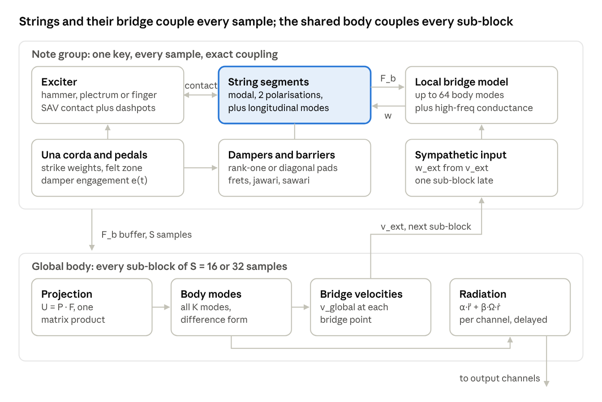
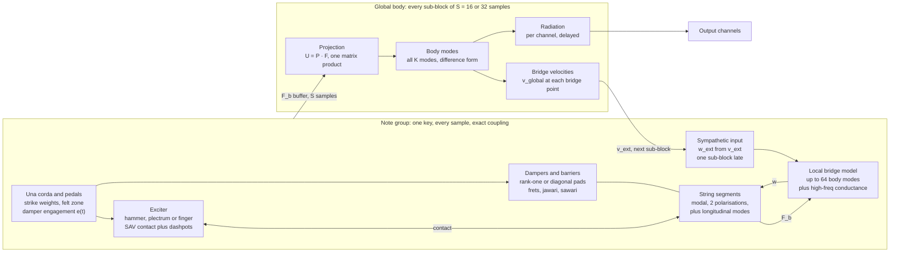

# Physical Modelling Engine Specification — Piano and Plucked Strings

Author: Guilherme da Silveira · Dated 2026-10-11 · Status: normative (SPEC keys).

> Canonical copy. Migrated from claude.ai Docs into this repository; edit it here. Planning documents are written and maintained by Opus agents only (see [CLAUDE.md](../../CLAUDE.md)).

## Scope, conventions and notation

This document defines how the engine computes sound: the physics, the discrete-time schemes, the order of operations and the function contracts. It is normative for implementers and deliberately says nothing about tooling, phasing or user interface. Where a section gives a formula, the code MUST compute that formula; where it gives a tolerance, a test MUST enforce it.

**Normative words.** MUST and MUST NOT are requirements. SHOULD is the default that may be departed from only with a written reason. MAY is optional.

**Units.** SI throughout: metres, kilograms, seconds, newtons, joules. User-facing frequencies are in hertz; everything internal uses angular frequency ω in rad/s. Decay rates σ are amplitude decay rates in s⁻¹, so a mode decays as e^(−σt) and its 60 dB decay time is T60 = 3 ln 10 / σ ≈ 6.91 / σ.

**Time.** The sample rate is fs, the time step Δt = 1/fs, and a superscript n is the sample index (uⁿ = u(nΔt)). A sub-block has S samples (S = 16 or 32); a host block has B samples, a whole number of sub-blocks except for a final partial one. The discrete operators are:

```math
\delta_{t+}u^n = \frac{u^{n+1}-u^n}{\Delta t},\quad \delta_{t-}u^n = \frac{u^{n}-u^{n-1}}{\Delta t},\quad \delta_{t\cdot}u^n = \frac{u^{n+1}-u^{n-1}}{2\Delta t},\quad \delta_{tt}u^n = \frac{u^{n+1}-2u^n+u^{n-1}}{\Delta t^2},\quad \mu_{t\cdot}u^n = \frac{u^{n+1}+u^{n-1}}{2}
```

**Symbols.**

| Symbol | Meaning | Unit |
| --- | --- | --- |
| L | Speaking length of a string | m |
| ρA | Linear mass density of a string (core plus winding) | kg/m |
| T | Tension at rest | N |
| E, I | Young's modulus of the core; second moment of area of the core (π d\_c⁴ / 64) | Pa; m⁴ |
| k\_n | Wavenumber of string mode n, nπ/L | rad/m |
| φ\_n(x) | String mode shape, orthonormal: ∫φ\_nφ\_m dx = δ\_nm | m^(−1/2) |
| q\_n | String modal coordinate; y(x,t) = Σ q\_n φ\_n(x) | m^(3/2) |
| ω\_n, σ\_n | Angular frequency and amplitude decay rate of a mode | rad/s; s⁻¹ |
| Φ\_k(x) | Body (soundboard) mode shape, mass-normalised: ∫ρh Φ\_kΦ\_l dA = δ\_kl | kg^(−1/2) |
| r\_k, Ω\_k | Body modal coordinate and its angular frequency | kg^(1/2)·m; rad/s |
| w\_b, F\_b | Bridge displacement at a string's bridge point; force from the strings on the bridge | m; N |
| Z₀ | String wave impedance, √(TρA) | kg/s |
| Y, G | Bridge admittance (velocity per force) and its real part (conductance) | s/kg |
| x\_H, m\_H | Hammer position and mass | m; kg |
| K, p | Felt stiffness coefficient and exponent of the contact law | N/m^p; – |
| ψ | Scalar auxiliary variable of a nonlinear potential | J^(1/2) |

**Sign conventions.** Each polarisation has an axis; the vertical axis +y points from the soundboard towards the strings. F\_b is the force the strings exert on the bridge along +y. Every exciter has an approach sign s\_E ∈ {+1, −1} giving the direction it pushes the string, set per instrument.

**Precision.** All compile-time quantities (mode tables, coefficients, fits) MUST be computed in float64. Real-time states MAY be float32 only in the difference form of the modal oscillator; energy monitors MUST accumulate in float64.

## Engine at a glance

The engine is a set of note groups that each advance exactly every sample, plus one shared body that advances once per sub-block. Everything inside a note group couples implicitly or exactly; the only approximation, a one-sub-block delay, sits on the sympathetic path between groups.





For small bodies (guitar, sitar, tanpura) the local bridge model is the whole body, so there is no global stage except radiation and no sympathetic delay. The sections that follow define each box: the modal oscillator underlies every mode, then strings, bridge coupling, bodies, the nonlinear framework, exciters, dampers and barriers.

## The modal oscillator

Every resonance in the engine (string mode, longitudinal mode, bridge mode, body mode) is one discrete oscillator. It reproduces the continuous mode's poles exactly at any sample rate and stays accurate in float32 when stored in difference form.

**Continuous mode.** f is the modal force per unit modal mass (all modes are normalised to unit modal mass):

```math
\ddot q + 2\sigma\dot q + \omega^2 q = f(t), \qquad \omega_d = \sqrt{\omega^2 - \sigma^2}
```

**Discrete scheme.** The engine uses the centred scheme with modified coefficients:

```math
\delta_{tt}q^n + 2\hat\sigma\,\delta_{t\cdot}q^n + \hat\omega^2 q^n = f^n
```

```math
\hat\sigma\Delta t = \tanh(\sigma\Delta t), \qquad \hat\omega^2\Delta t^2 = 2 - 2\,(1+\hat\sigma\Delta t)\,e^{-\sigma\Delta t}\cos(\omega_d\Delta t)
```

With these values the discrete poles are exactly e^((−σ ± iω\_d)Δt), so free decay and frequency are exact. The compiler MUST evaluate ω̂²Δt² without cancellation, in float64:

```math
\hat\omega^2\Delta t^2 = 2\left[-\mathrm{expm1}(-\sigma\Delta t) + 2e^{-\sigma\Delta t}\sin^2\!\left(\tfrac{\omega_d\Delta t}{2}\right)\right] - 2\,\hat\sigma\Delta t\, e^{-\sigma\Delta t}\cos(\omega_d\Delta t)
```

**Difference form (normative state).** Each oscillator stores qⁿ and uⁿ = qⁿ − qⁿ⁻¹, never qⁿ⁻¹ itself:

```math
u^{n+1} = \beta\,u^n - \kappa\,q^n + \gamma\,f^n, \qquad q^{n+1} = q^n + u^{n+1}
```

```math
\beta = \frac{1-\hat\sigma\Delta t}{1+\hat\sigma\Delta t}, \qquad \kappa = \frac{\hat\omega^2\Delta t^2}{1+\hat\sigma\Delta t}, \qquad \gamma = \frac{\Delta t^2}{1+\hat\sigma\Delta t}
```

This is algebraically identical to the scheme above but keeps the small quantity κ at full relative precision. In a check for this spec at 48 kHz, the float32 difference form held an A0 mode (27.5 Hz) within 0.001 cent; the usual two-term recursion qⁿ⁺¹ = a qⁿ + b qⁿ⁻¹ in float32 drifted 1.6 cents.

**Derived quantities.** Half-step velocity v^(n+½) = uⁿ⁺¹ / Δt. Centred velocity δ\_t· qⁿ = (uⁿ⁺¹ + uⁿ) / (2Δt). Centred acceleration δ\_tt qⁿ = (uⁿ⁺¹ − uⁿ) / Δt².

**Discrete energy.** For one oscillator of unit modal mass the quantity below is conserved when σ = 0 and f = 0, and it is non-negative whenever ω̂Δt < 2. Energy monitors MUST use it:

```math
H^{n+1/2} = \tfrac12\left(\frac{u^{n+1}}{\Delta t}\right)^2 + \tfrac12\,\hat\omega^2\, q^n q^{n+1}, \qquad H^{n+1/2}-H^{n-1/2} = \Delta t\left[-2\hat\sigma\,(\delta_{t\cdot}q^n)^2 + f^n\,\delta_{t\cdot}q^n\right]
```

**Bandwidth.** A mode MUST be dropped if ω\_dΔt > 0.95π, if its frequency exceeds the instrument's f\_max, or if σ ≥ ω (overdamped). Only modes kept by this rule exist; nothing in the engine aliases from modal truncation.

**Time-varying parameters.** When ω or σ changes (bending, tension modulation, damper engagement), the state (qⁿ, uⁿ) is kept and only β, κ, γ are recomputed. Changes larger than 0.1% per sub-block MUST be ramped linearly over the sub-block.

**Contract.** `OscCoeffs compileOscillator(double omega, double sigma, double fs)` returns β, κ, γ (stored float32) and ω̂², σ̂ (kept float64 for energy monitors and coupling terms). It MUST fail if the bandwidth rule rejects the mode.

## Stiff string model

Each string is a damped stiff (Euler–Bernoulli) string with two transverse polarisations, expanded on pinned–pinned modes. Length, diameters, densities, modulus and target pitch fully determine its mode table; losses are three parameters plus an optional per-partial override.

**Equation of motion** (per polarisation; f is an external force density in N/m, losses are applied per mode):

```math
\rho A\,\partial_t^2 y = T\,\partial_x^2 y - EI\,\partial_x^4 y + f(x,t), \qquad y = \partial_x^2 y = 0 \ \text{at } x = 0 \text{ (static end) and at } x = L \text{ (bridge end, see Bridge coupling)}
```

**Modes.**

```math
\phi_n(x) = \sqrt{2/L}\,\sin(k_n x), \quad k_n = \frac{n\pi}{L}, \quad \omega_n^2 = \frac{T k_n^2 + EI k_n^4}{\rho A} = n^2\omega_0^2\,(1 + B n^2), \quad \omega_0 = \frac{\pi}{L}\sqrt{\frac{T}{\rho A}}, \quad B = \frac{\pi^2 EI}{T L^2}
```

Clamped ends MAY be selected per string; the engine then keeps pinned shapes and corrects frequencies with Fletcher's factor, f\_n ≈ n f₀ √(1 + B n²) (1 + 2√B/π + 4B/π²).

**Wound strings.** Mass comes from core and winding, bending stiffness from the core only (winding stiffness MAY be added as a fraction ε\_w of the core's EI):

```math
\rho A = \frac{\pi}{4}\left[\rho_c d_c^2 + \eta_w\,\rho_w\,(d_o^2 - d_c^2)\right], \qquad EI = (1+\varepsilon_w)\,\frac{\pi E_c d_c^4}{64}
```

d\_c is the core diameter, d\_o the outer diameter, ρ\_c and ρ\_w the core and winding densities, η\_w the winding packing factor (0.75–0.9 for round wire).

**Tension for pitch.** Given a target first-partial frequency f₁ (from the tuning curve), the tension is closed-form, stiffness included:

```math
T = 4L^2\rho A\, f_1^2 - \frac{\pi^2 EI}{L^2}
```

The tuning curve supplies f₁ per string as equal temperament (A4 = 440 Hz by default) plus a per-key stretch in cents plus the string's unison detune in cents. Tension MUST be recomputed whenever any of these, or the geometry, changes.

**Losses.** Intrinsic string losses (internal friction, air, viscoelasticity) are:

```math
\sigma_n = b_1 + b_2\sqrt{\omega_n} + b_3\,\omega_n^2
```

A per-partial table MAY override σ\_n for fitted instruments. Bridge losses are NOT part of σ\_n; they emerge from the bridge coupling. Values fitted from recordings MUST have the predicted bridge loss subtracted first, or bridge damping is counted twice.

**Forces and observations.** The modal force (per unit modal mass) from a force F spread by a unit-area window g(x) around x₀, and the matching observed displacement, use the same window-averaged shape φ̄\_n, which keeps exciters energy-consistent:

```math
f_n = \frac{F}{\rho A}\,\bar\phi_n, \qquad y_g = \int g\,y\,dx = \sum_n \bar\phi_n q_n, \qquad \bar\phi_n = \phi_n(x_0)\,W(k_n)
```

For a point, W = 1. For a rectangular window of width b, W(k) = sin(kb/2)/(kb/2). For a raised-cosine (Hann) window of full width b, the default for hammers and fingers:

```math
W(k) = \frac{\sin(kb/2)}{kb/2}\cdot\frac{\pi^2}{\pi^2 - (kb/2)^2}
```

**Energy.** Modal mass is ρA, so the string's energy is ρA Σ H\_n with H\_n from the oscillator section; energy monitors MUST include the factor.

**Polarisations.** Vertical (v) and horizontal (h) polarisations share the mode table; h MAY carry a small detune Δ\_h (cents) for termination anisotropy. They interact only through the bridge admittance and the nonlinear terms. An exciter acts along its own direction; the hammer is vertical with an optional horizontal fraction ε\_H.

**Duplex and rear segments.** The segment between bridge and hitch pin is a separate short string with its own L\_d and the same T, ρA and EI. Its moving end is at x = 0, so its lifting function is 1 − x/L\_d. It has no exciter, feeds force into the bridge, and carries a mute parameter m\_d ∈ \[0, 1\] that adds damping σ\_mute = m\_d · σ\_felt.

**Truncation.** Keep n = 1 … N with N the largest index whose ω\_d,n satisfies the oscillator bandwidth rule.

**Contract.** `StringModes compileString(const StringParams&, double fs, double fMax)` computes T, B, the k, ω, σ tables and oscillator coefficients for both polarisations, and the shape vectors φ̄ at every registered point (exciter, damper, barrier, bridge). All shape values MUST be computed in float64 and stored float32.

## Bridge coupling

The bridge end of every string moves with the bridge. A lifting function turns that motion into a modal force, and the force the string puts on the bridge is a dot product over its modes. Checked numerically for this spec, the scheme below reproduces wave theory's bridge damping to 1 part in 10⁴, and two strings on one bridge show the expected in-phase and anti-phase decays.

**Decomposition.** The bridge displacement w\_b(t) enters through a static lifting function ψ(x) that satisfies the pinned conditions (ψ'' = 0), so the stiffness term adds nothing:

```math
y(x,t) = \sum_n q_n(t)\,\phi_n(x) + w_b(t)\,\psi(x), \qquad \psi(x) = \begin{cases} x/L & \text{bridge at } x = L \text{ (speaking segment)} \\ 1 - x/L & \text{bridge at } x = 0 \text{ (rear or duplex segment)} \end{cases}
```

**Modal equation with a moving support.**

```math
\ddot q_n + 2\sigma_n\dot q_n + \omega_n^2 q_n = f_n - g_n\,\ddot w_b, \qquad g_n = \langle\psi,\phi_n\rangle = \begin{cases} \sqrt{2/L}\,(-1)^{n+1}/k_n & \psi = x/L \\ \sqrt{2/L}\,/k_n & \psi = 1 - x/L \end{cases}
```

**Bridge force.** The force a segment exerts on the bridge along +y has the same form for both kinds of segment:

```math
F_b = \rho A\sum_n \hat\omega_n^2\, g_n\, q_n - \frac{T}{L}\,w_b
```

The discrete ω̂ₙ² MUST be used, not ωₙ². The engine simulates dynamic deviations only; the static downbearing load is excluded. Each segment precomputes the float32 vector a\_n = ρA ω̂ₙ² g\_n, so F\_b is one SIMD dot product plus one scalar term.

**Discrete coupling order (normative, per sample).**

1. Every segment attached to bridge point b computes F\_b,s from qⁿ and w\_bⁿ; the point's total force is F\_b = Σ\_s F\_b,s.
2. The bridge model at that point advances with F\_b to give w\_bⁿ⁺¹ (Soundboard section).
3. Every attached segment advances its modes with modal force f\_n − g\_n δ\_tt w\_bⁿ, where δ\_tt w\_bⁿ = (w\_bⁿ⁺¹ − 2w\_bⁿ + w\_bⁿ⁻¹) / Δt².

This partitioned order is explicit: no solve is needed for the bridge itself. When a segment also has implicit nonlinear terms (hammer, damper, collisions), step 3 is part of that segment's low-rank solve, with the bridge term known.

**Unison coupling.** All strings of a note, plus its rear and duplex segments, share one bridge point and one w\_b. Weinreich's coupled-string effects (double decay, beating, una corda aftersound) then emerge without extra code. Real unison strings attach at slightly different points; the engine SHOULD treat them as one point.

**Polarisation coupling.** The bridge has a 2×2 admittance in its own frame, rotated by an angle θ\_b from the string polarisations:

```math
\begin{bmatrix} F_\parallel \\ F_\perp \end{bmatrix} = R(\theta_b)\begin{bmatrix} F_v \\ F_h \end{bmatrix}, \qquad \begin{bmatrix} w_v \\ w_h \end{bmatrix} = R(\theta_b)^{\mathsf T}\begin{bmatrix} w_\parallel \\ w_\perp \end{bmatrix}
```

w\_∥ comes from the soundboard bridge model. w\_⊥ comes from a horizontal model that defaults to a pure conductance G\_h, integrated as w\_⊥ⁿ⁺¹ = w\_⊥ⁿ + Δt G\_h F\_⊥ⁿ. With θ\_b = 0 the polarisations are independent; a small θ\_b gives the slow vertical-to-horizontal energy exchange heard in piano aftersound.

**Small-admittance results (used as oracles).** For a string of fundamental f₀ and impedance Z₀ on a bridge of admittance Y(ω), with Z₀|Y| ≪ 1:

```math
\sigma_{n,\text{bridge}} \approx 2 f_0 Z_0\,\mathrm{Re}\,Y(\omega_n), \qquad \Delta\omega_n \approx -2 f_0 Z_0\,\mathrm{Im}\,Y(\omega_n)
```

For a pure conductance G the exact value is σ = −f₀ ln\[(1 − Z₀G)/(1 + Z₀G)\]. Two identical strings on one conductance: in-phase motion decays at 4 f₀ Z₀ G and anti-phase motion only at the intrinsic rate.

**Contract.** `SegmentBridgeTerms compileBridgeTerms(const StringModes&, BridgeEnd end)` returns g\_n, a\_n and T/L. `float bridgeForce(const SegmentBridgeTerms&, const float* q, float wb)` returns F\_b.

## Soundboard and bodies

A body (piano soundboard, guitar top and cavity, sitar gourd) is a set of mass-normalised modes computed offline from its materials and geometry. At run time each bridge point gets a small exact local model for its own strings, and one shared global model radiates sound and carries sympathetic coupling between notes.

**Plate model (offline).** The soundboard is an orthotropic plate of thickness h(x, y), with grain angle θ\_g, ribs and bridges as attached beams, and an elastically supported rim. Thick-plate (Reissner–Mindlin) theory MAY replace Kirchhoff theory, as in the Chabassier model. The Kirchhoff form in the grain frame (L along the grain, R across it) is:

```math
\rho h\,\partial_t^2 w + \partial_L^2\!\left(D_{11}\partial_L^2 w + D_{12}\partial_R^2 w\right) + \partial_R^2\!\left(D_{12}\partial_L^2 w + D_{22}\partial_R^2 w\right) + 4\,\partial_L\partial_R\!\left(D_{66}\,\partial_L\partial_R w\right) = f
```

```math
D_{11} = \frac{E_L h^3}{12(1-\nu_{LR}\nu_{RL})}, \quad D_{22} = \frac{E_R h^3}{12(1-\nu_{LR}\nu_{RL})}, \quad D_{12} = \nu_{RL} D_{11}, \quad D_{66} = \frac{G_{LR} h^3}{12}
```

Moisture content MC changes E\_L, E\_R, G\_LR and density through linear coefficients supplied with the wood data. Crown and downbearing MAY be included as a static prestress (geometric stiffness) in the eigen-solve.

**Modal data (offline output).** K modes up to the body's f\_max, each with Ω\_k, Φ\_k at every bridge point, and a decay rate built from the wood loss factor η(ω) and the radiation damping σ\_k,rad obtained from the radiation integral below:

```math
\ddot r_k + 2\sigma_k\dot r_k + \Omega_k^2 r_k = \sum_b \Phi_k(x_b)\,F_b, \qquad \sigma_k = \tfrac12\,\eta(\Omega_k)\,\Omega_k + \sigma_{k,\text{rad}}, \qquad w(x_b) = \sum_k \Phi_k(x_b)\,r_k
```

**Local bridge model (per bridge point, per sample, exact).** Bridge point b keeps private copies of the M\_b body modes with the largest Φ\_k(x\_b)² below f\_split (M\_b ≤ 64 SHOULD hold), plus a conductance for everything above:

```math
w_b = \sum_{k\in\mathcal M_b}\Phi_k(x_b)\,r_k^{(b)} + w_{b,R}, \qquad \ddot r_k^{(b)} + 2\sigma_k\dot r_k^{(b)} + \Omega_k^2 r_k^{(b)} = \Phi_k(x_b)\,F_b, \qquad w_{b,R}^{n+1} = w_{b,R}^n + \Delta t\, G_{hf,b}\, F_b^n
```

G\_hf,b is the mean real part of the residual mobility (full mobility minus the kept modes) over \[f\_split, f\_max\], computed by the compiler. For a plate far from edges it approaches the infinite-plate value 1/(8√(D\_eff ρh)) with D\_eff ≈ √(D₁₁ D₂₂), which is a sanity check, not the value to use. The private modes advance with the force at step n, so w\_bⁿ⁺¹ is explicit, as the bridge coupling order requires.

**Global body (shared, per sub-block).** All K modes run once per sub-block of S samples, driven by the bridge forces the note groups recorded:

1. Projection: U = P · F, with P the K × B\_active matrix of Φ\_k(x\_b) over active bridge points and F the B\_active × S force buffer. This is one matrix–matrix product.
2. Each mode advances S samples in difference form from its row of U.
3. Radiation: output channel c receives Σ\_k \[α\_c,k r̈\_k + β\_c,k Ω\_k ṙ\_k\], delayed by an integer per-channel delay τ\_c.
4. Sympathetic feedback: v\_b,global = Σ\_k Φ\_k(x\_b) ṙ\_k for every bridge point with free strings, another matrix–matrix product.

**Radiation weights (offline).** From the Rayleigh integral for a baffled plate, a complex gain per mode and channel position R\_c, with the common delay R\_c / c₀ removed and applied as τ\_c:

```math
A_{c,k} = \frac{\rho_0}{2\pi}\int \Phi_k(\mathbf x)\,\frac{e^{-i\Omega_k |\mathbf R_c - \mathbf x|/c_0}}{|\mathbf R_c - \mathbf x|}\,dA\; e^{\,i\Omega_k R_c/c_0}, \qquad \alpha_{c,k} = \mathrm{Re}\,A_{c,k}, \quad \beta_{c,k} = -\mathrm{Im}\,A_{c,k}
```

The real-time sum is exact at each mode's own frequency. A lid or case MAY be represented by a measured or simulated correction filter per channel.

**Sympathetic path.** In sub-block j + 1, bridge point b receives an external bridge velocity from sub-block j, and its strings see w\_b + w\_b,ext:

```math
v_{b,\text{ext}} = \kappa_s\,\mathrm{LP}_{f_{\text{symp}}}\!\left[v_{b,\text{global}} - v_{b,\text{local}}\right], \qquad w_{b,\text{ext}}^{n+1} = w_{b,\text{ext}}^n + \Delta t\, v_{b,\text{ext}}^n
```

Subtracting the local velocity removes each point's response to its own force, which the local model already provides exactly; what remains is the motion caused by every other note. κ\_s ∈ \[0, 1\] defaults to 1, and LP is a second-order low-pass at f\_symp (default 5 kHz). This path is an approximation with one sub-block of delay, so it carries a guard: if a note group's energy rises for 4 consecutive sub-blocks with no exciter in contact and no key event, its κ\_s MUST halve, and the event is logged.

**Small bodies.** If a body has K ≤ 256 modes and at most 8 bridge points (guitar, sitar, tanpura, kantele, shamisen), all bridge points MUST couple to all body modes exactly every sample; there is no local/global split and no sympathetic delay.

**Reference mode.** The engine MUST also offer an offline mode in which every bridge point couples to all K modes every sample on one thread. It is the yardstick for the sympathetic approximation.

**Contracts.** `BodyModes compileBody(const BodyParams&, span<const Point> bridgePoints, span<const Point> channels)` (offline). `LocalBridge buildLocalBridge(const BodyModes&, int point, int maxModes, double fSplit)`. `void GlobalBody::processSubBlock(const ForceBuffer&, int S, AudioOut&, BridgeVelocityOut&)`.

## Nonlinear framework

Every conservative nonlinearity (hammer felt, collisions, tension modulation) uses one scalar auxiliary variable (SAV) per segment, and every nonlinear dissipation is a dashpot along a contact direction. The resulting update is explicit: a rank-r correction with r ≤ 4, solved in O(N) per sample. In a check for this spec, a hammer striking a modal string conserved total energy to 7 × 10⁻¹⁴ relative, and a mass hitting a rigid felt contact matched the analytic contact time within 0.4% at 48 kHz.

**Coordinates.** A segment's unknowns are its modal coordinates plus any lumped coordinates attached to it (hammer, plectrum, finger), stacked as z with masses m\_i (ρA for string modes, m\_H for a hammer). Each coordinate has its oscillator coefficients from the modal oscillator section; a free lumped mass has ω̂ = σ̂ = 0 and γ = Δt².

**SAV formulation.** For a potential V(z) ≥ 0, with a small constant ε₀ > 0 (default 10⁻¹² J):

```math
\psi = \sqrt{2\,(V+\varepsilon_0)}, \qquad \nabla V = \psi\,\mathbf g, \qquad \mathbf g = \frac{\nabla V}{\sqrt{2\,(V+\varepsilon_0)}}
```

**Discrete scheme.** ψ lives on half steps; **g**ⁿ is evaluated at zⁿ:

```math
\delta_{tt}z_i^n + 2\hat\sigma_i\,\delta_{t\cdot}z_i^n + \hat\omega_i^2 z_i^n = \frac{1}{m_i}\left[F_i^n - g_i^n\,\frac{\psi^{n+1/2}+\psi^{n-1/2}}{2} - R^n c_i\,\mathbf c^{\mathsf T}\delta_{t\cdot}\mathbf z^n\right], \qquad \psi^{n+1/2} = \psi^{n-1/2} + \tfrac12\,(\mathbf g^n)^{\mathsf T}\left(\mathbf z^{n+1} - \mathbf z^{n-1}\right)
```

F\_iⁿ holds explicit forces (bridge acceleration term, pluck pulses). The last term is a dissipative dashpot of coefficient Rⁿ ≥ 0 along contact direction **c** (Hunt–Crossley, damper felt). The conserved energy is the sum of m\_i H\_i over all coordinates plus ½(ψ^(n+½))² − ε₀; the dashpot only removes energy.

**Explicit low-rank solve.** Substituting the ψ update makes zⁿ⁺¹ appear linearly through r rank-one terms. Write the update as zⁿ⁺¹ = **a** − Σ\_j **h**\_j (**w**\_jᵀ zⁿ⁺¹) with:

- **a**: the free oscillator update (zero force) plus all terms known at step n, including −**h**\_g ψ^(n−½) + **h**\_g (**g**ᵀzⁿ⁻¹)/4 and the known part of each dashpot.
- SAV pair: **h**\_g = γ ⊙ **g** / m, **w** = **g** / 4.
- Dashpot pair: **h**\_c = Rⁿ γ ⊙ **c** / m, **w** = **c** / (2Δt).

With H = \[**h**\_1 … **h**\_r\] and W = \[**w**\_1 … **w**\_r\] (N × r), the Woodbury identity gives the update. For one contact, **g** and **c** are parallel and r = 1, which reduces to a scalar division:

```math
\mathbf z^{n+1} = \mathbf a - H\left(I_r + W^{\mathsf T}H\right)^{-1} W^{\mathsf T}\mathbf a, \qquad r = 1:\quad \mathbf z^{n+1} = \mathbf a - \mathbf h\,\frac{\mathbf w^{\mathsf T}\mathbf a}{1 + \mathbf w^{\mathsf T}\mathbf h}
```

All contacts of one segment share one ψ (their potentials add), so SAV always contributes rank 1. Dashpots contribute one rank per distinct contact direction; with more than 3 a segment MUST lump its dashpots into the diagonal approximation of the Dampers section.

**Skipping.** When Vⁿ = 0 and every dashpot has Rⁿ = 0, the update is the free oscillator update and the solve MUST be skipped.

**Drift control.** ψ can drift away from √(2(V + ε₀)); a drift above that value acts as extra stiffness at the next contact. Two rules apply:

1. **Reset at separation (MUST).** When Vⁿ = Vⁿ⁻¹ = 0, set ψ ← √(2ε₀). This can only remove energy.
2. **Persistent contact (SHOULD).** For contacts that last longer than 50 ms (jawari, stopped strings, dampers), apply a published drift regulation such as power-balanced regulation, or at least relax ψ towards √(2(V + ε₀)) with time constant 10 ms only when ψ is above it.

**Contracts.** `struct Potential { double value(const State&); void gradient(const State&, span<float> g); }`. `void savStep(Segment&, span<const Potential*>, span<const Dashpot>, span<const float> explicitForce)` performs one sample of the update above, including the ψ update, the reset rule and the skip rule.

## Hammer and action

The hammer is a lumped mass launched at the string with a velocity set by the key; it contacts each string of the note through a nonlinear felt law and leaves on its own. Una corda changes which strings are struck and which part of the felt strikes them. Values marked typical are starting points to be fitted per instrument.

**Velocity map.** Normalised key velocity ν ∈ (0, 1\] (CLAP note velocity, or MIDI velocity / 127) sets the hammer velocity at contact:

```math
v_H = v_{\min} + (v_{\max} - v_{\min})\,\nu^{\gamma_v}
```

Typical v\_min = 0.3 m/s, v\_max = 6 m/s, γ\_v = 1.5. The engine MUST NOT add action latency by default: the hammer is launched at a gap of v\_H Δt from the string, so contact starts on the next sample.

**Hammer coordinate.** x\_H is measured along the hammer's travel, positive towards the string; s\_E is the instrument's approach sign. The hammer has mass m\_H (typical 4–12 g, heavier in the bass), no stiffness and no damping of its own. A flexible shank MAY be added as one extra oscillator between drive and head.

**Contact with each struck string.** The hammer meets string s over a raised-cosine window of width b\_H (typical 5–15 mm) centred at the strike point x\_c = β\_c L (typical β\_c ≈ 1/7–1/9 mid-keyboard, smaller in the treble). The penetration uses the window-averaged displacement along the hammer direction:

```math
\delta_s = x_H - s_E\sum_n \bar\phi_{s,n}\,q_{s,n}, \qquad V_H = \sum_s w_s\,\frac{K_s}{p_s+1}\,[\delta_s]_+^{\,p_s+1}
```

w\_s ∈ \[0, 1\] is the strike weight from the una corda map. Typical p is between about 2 and 4. V\_H is one potential in the segment's SAV.

**Felt dissipation (default: Hunt–Crossley).** Each struck string adds a dashpot along its contact direction c\_s = ∂δ\_s/∂z (+1 on x\_H, −s\_E φ̄\_s,n on that string's modes):

```math
R_s^n = w_s K_s\,\mu_{HC}\,[\delta_s^n]_+^{\,p_s}
```

μ\_HC (s/m) sets the hysteresis loss; a trichord gives r = 1 + 3 = 4, the maximum the low-rank solve allows.

**Alternative: Stulov hereditary felt.** The force is K(δ^p − εh), where h is δ^p passed through a one-pole low-pass of time constant τ (ε is the hereditary amplitude, τ the relaxation time, both fitted). The elastic part stays in the SAV; the hereditary part is an explicit force at step n:

```math
h^n = a\,h^{n-1} + (1-a)\,[\delta^n]_+^{\,p}, \quad a = e^{-\Delta t/\tau}, \qquad F_{\text{hered}}^n = -K\varepsilon\,h^n \ \text{along } c_s
```

This variant is not provably passive; energy monitors MUST check it.

**Release and check.** After rebound the hammer leaves the coordinate set when it is farther than d\_check (default 5 mm) from the string and moving away. A double strike in the bass needs no special code: the contact law handles it.

**Repetition.** A new note-on for a key whose hammer is still in flight replaces the hammer's velocity with the new v\_H and re-launches it from its current position if that is within d\_check, or from the launch gap otherwise. The string keeps its state, so re-striking a moving string is physical.

**Una corda (grand).** Shift s ∈ \[0, 1\], continuous. Strike weights use a smoothstep S between s₀ and s₁ (defaults 0.3 and 0.9):

| Note type | String that leaves the hammer | Strike weights |
| --- | --- | --- |
| Trichord | String 1 | w₁ = 1 − S(s), w₂ = w₃ = 1 |
| Bichord | String 1 | w₁ = 1 − S(s), w₂ = 1 |
| Single string | None | w₁ = 1 |

The strings that remain are struck by unworn felt between the string grooves, so stiffness and exponent change with s:

```math
K_s(s) = K_s\,[1 - s\,(1-\kappa_{uc})], \qquad p_s(s) = p_s + s\,\Delta p_{uc}
```

κ\_uc (typical 0.6) and Δp\_uc (default 0) are fitted. The un-struck string still shares the bridge, so its aftersound comes from the bridge coupling, as in [Miranda Valiente et al. (2024)](https://eprints.soton.ac.uk/499445).

**Soft pedal (upright).** The hammer rail moves closer, so v\_H is scaled by (1 − s ρ\_up), typical ρ\_up = 0.3; struck strings do not change.

**Oracle.** A mass m hitting a rigid felt contact K\[δ\]₊^p at speed v rebounds at −v (no dissipation) after the time below; contact time therefore scales as v^((1−p)/(1+p)).

```math
t_c = 2\,\frac{\delta_m}{v}\,\frac{\sqrt{\pi}\;\Gamma\!\left(1+\tfrac{1}{p+1}\right)}{\Gamma\!\left(\tfrac12+\tfrac{1}{p+1}\right)}, \qquad \delta_m = \left(\frac{(p+1)\,m v^2}{2K}\right)^{1/(p+1)}
```

**Contracts.** `void launchHammer(NoteGroup&, float nu, float shift)`. `HammerPotential : Potential` (value and gradient of V\_H). `void hammerDashpots(const NoteGroup&, span<Dashpot> out)`.

## Dampers and pedals

A damper is a felt pad pressed on the string: a spring and dashpot at one window, scaled by an engagement e ∈ \[0, 1\] that follows the key, the sustain pedal and the sostenuto latch. The default applies it as extra per-mode damping; an exact rank-one variant is available.

**Damper model.** Pad centred at x\_d with width b\_d (raised-cosine window, shape vector φ̄\_d), stiffness K\_d and resistance R\_d, acting on the vertical polarisation.

- **Diagonal (default).** Each mode gets extra damping and stiffness, and its oscillator coefficients are recomputed whenever e changes (ramped per the modal oscillator rules). This neglects mode-to-mode transfer by the pad.

```math
\sigma_{n,d} = \frac{e\,R_d\,\bar\phi_{d,n}^2}{2\rho A}, \qquad \omega_{n,d}^2 = \omega_n^2 + \frac{e\,K_d\,\bar\phi_{d,n}^2}{\rho A}
```

- **Rank-one (MAY).** Spring and dashpot act along c = φ̄\_d, with the spring on the centred average μ\_t·z so the step is energy-stable. In the low-rank solve this is one pair: **h** = γ ⊙ e**c**/m and **w** = **c** (K\_d/2 + R\_d/(2Δt)).

**Lift fraction.** Damper lift l ∈ \[0, 1\] is the larger of the key's and the sustain pedal's contribution:

```math
l = \max(l_{\text{key}},\ l_{\text{ped}}), \qquad l_{\text{ped}} = \mathrm{clamp}\!\left(\frac{P - P_0}{P_1 - P_0},\,0,\,1\right), \qquad e_{\text{target}} = (1-l)^{\eta_d}
```

P ∈ \[0, 1\] is sustain pedal depth; P₀ and P₁ bound the half-pedal region (defaults 0.35 and 0.65); η\_d shapes the felt's progressive contact (default 2). l\_key is 1 while the key is down, or the key's continuous depth when the controller provides it.

**Timing.** e follows e\_target with a one-pole time constant: τ\_up = 4 ms when lifting, τ\_down when landing. Faster key release lands faster: τ\_down = τ₀ / (1 + k\_r ν\_rel) with release velocity ν\_rel ∈ \[0, 1\], defaults τ₀ = 12 ms and k\_r = 2.

**Sostenuto.** When the sostenuto pedal goes down, every key whose damper is lifted by its key at that instant is latched with l\_key = 1 until the pedal is released. Keys pressed later behave normally.

**Undamped notes.** Each key has a hasDamper flag; the top of a piano keyboard (typically the highest 18–20 keys) has none and always behaves as l = 1.

**Landing noise (MAY).** A damper landing on a moving string MAY be modelled as a one-sided contact (collision potential) instead of a linear spring, which produces the light buzz of a damper meeting a large vibration.

**Other felts.** Rear-segment mutes use the constant σ\_mute from the stiff string section. Harpsichord dampers are the same model placed on the jack, engaged on key release.

**Contracts.** `void updateDampers(NoteGroup&, const PedalState&, const KeyState&)` sets e\_target per sub-block. `void rampDampers(NoteGroup&, int sample)` advances e and refreshes coefficients per sample while e is moving.

## Geometric nonlinearity and longitudinal waves

Large transverse motion stretches the string. The default tier models this in two parts: a global tension modulation acting back on the transverse modes (pitch glide, partial coupling), and longitudinal modes driven one-way by the transverse slope (phantom partials and the longitudinal precursor). The formulas below were checked numerically against direct quadrature for this spec.

**Tension modulation (Kirchhoff–Carrier).** The extra tension and its potential, summed over both polarisations with orthonormal modes:

```math
\Delta T = \frac{EA - T}{2L}\,S, \qquad S = \int_0^L (y_x^2 + z_x^2)\,dx = \sum_n k_n^2\left(q_{v,n}^2 + q_{h,n}^2\right), \qquad V_{KC} = \frac{EA - T}{8L}\,S^2
```

```math
\frac{\partial V_{KC}}{\partial q_{\cdot,n}} = \frac{EA - T}{2L}\,S\,k_n^2\,q_{\cdot,n} = \Delta T\,k_n^2\,q_{\cdot,n}
```

EA here is the core's axial stiffness E\_c π d\_c²/4. V\_KC joins the segment's SAV potential (the same ψ as the hammer), so the solve stays rank 1. Because V\_KC is non-zero whenever the string sounds, the skip rule does not apply and the persistent-contact drift rule does.

**Longitudinal modes.** Fixed at both ends, with the core's stiffness and the full linear mass:

```math
\chi_m(x) = \sqrt{2/L}\,\sin(K_m x), \quad K_m = \frac{m\pi}{L}, \quad \omega_m^{L} = K_m\sqrt{\frac{EA}{\rho A}}, \qquad \rho A\,\xi_{tt} = EA\,\xi_{xx} + \frac{EA - T}{2}\,\partial_x\!\left(y_x^2 + z_x^2\right)
```

The modal forcing per unit modal mass reduces to a pair sum over transverse modes (P is the polarisation set {v, h}):

```math
f_m^{L} = -\frac{(EA - T)\,K_m}{2\rho A\sqrt{2L}}\sum_{P}\ \sum_{i,j\ge 1} k_i k_j\, q_{P,i}\, q_{P,j}\left[\delta_{i+j,\,m} + \delta_{|i-j|,\,m}\right]
```

The pair sum costs O(N) per longitudinal mode and MUST be used for M\_L ≤ 16 modes (default M\_L = 8 within f\_max). Larger M\_L MAY evaluate y\_x on a grid with a fast cosine transform, square it and project. Longitudinal modes use the modal oscillator with this explicit force at step n; their losses use their own b₁, b₃.

**Longitudinal force at the bridge.**

```math
F_L = EA\sum_m \sqrt{2/L}\,K_m\,(-1)^m\,\xi_m + \frac{EA - T}{2}\,y_x(L)^2
```

**Transmission to the body.** Longitudinal force and tension modulation reach the bridge's vertical axis through geometry: the downbearing angle, bridge tilt, and for bridgeless or knotted terminations (kantele, tanbur) the termination angle. The engine adds both to the bridge force:

```math
F_{b,v} \mathrel{+}= \kappa_L\,F_L + \kappa_T\,\Delta T
```

Typical κ\_L = sin 1.5° ≈ 0.026 for a piano; κ\_T is 0 for a piano and set from the termination angle for kantele-type terminations. Both are fitted.

**Neglected in the default tier.** Back-coupling from longitudinal motion to the transverse modes, and spatially varying tension.

**High-quality tier (MAY).** Replace both parts with the geometrically exact string, whose potential couples transverse and longitudinal motion fully, integrated with the same SAV framework. [Ducceschi, Bilbao and Webb](https://cris.unibo.it/handle/11585/883682) report running this below real time for typical struck piano strings in C++; [Ducceschi & Bilbao (2022)](https://www.research.ed.ac.uk/en/publications/simulation-of-the-geometrically-exact-nonlinear-string-via-energy/) give the energy-quadratised scheme.

**Contracts.** `TensionModulationPotential : Potential`. `void longitudinalForce(const Segment&, span<float> fL)` computes f\_m^L by pair sums. `float longitudinalBridgeForce(const Segment&)` returns F\_L.

## Plucked exciters and barriers

Plucked instruments add exciters that hold and release the string, and barriers the string collides with. All of them are SAV potentials or dashpots on the string segment, so they use the same low-rank update as the hammer.

**Exciters.**

| Exciter | Model | Release rule | Parameters |
| --- | --- | --- | --- |
| Force pulse (generic pluck) | Explicit raised-cosine force of duration t\_p and peak F\_p over a window at x\_p; split into polarisations by angle θ\_p | Ends at t\_p | t\_p (0.5–5 ms), F\_p, x\_p, b\_p, θ\_p |
| Plectrum (pick, quill, mizrab, bachi) | Tip mass m\_p on a spring K\_p to a driver moving at v\_d along the pluck direction; tip–string contact is a one-sided power law | Contact removed (ramped over 0.2 ms) once driver position minus string displacement at the tip exceeds h\_slip | m\_p, K\_p, v\_d, h\_slip, contact K and α |
| Finger | As plectrum, with a wide soft contact (b\_f ≈ 10 mm) and Hunt–Crossley flesh damping | Same rule; h\_slip larger | m\_f, K\_f, α\_f, μ\_f, b\_f |
| Initial displacement (oracle and presets) | String released from a triangle of height A at x\_p | At t = 0 | A, x\_p |

The triangle start is closed-form (checked against quadrature for this spec):

```math
q_n(0) = \sqrt{2/L}\;\frac{A\,L\,\sin(k_n x_p)}{k_n^2\,x_p\,(L - x_p)}, \qquad u_n(0) = 0
```

**Distributed barriers.** A barrier is a profile b(x) on one side s\_b of the string, sampled at J points x\_j with quadrature weights Δx\_j (spacing ≤ 0.2 mm on bridges, ≤ 2 mm on fretboards). Penetration and potential:

```math
\eta_j = s_b\left(b(x_j) - \sum_n \phi_n(x_j)\,q_n\right), \qquad V_B = \sum_j \Delta x_j\,\frac{K_B}{\alpha+1}\,[\eta_j]_+^{\,\alpha+1}
```

The J × N matrix φ\_n(x\_j) is compiled once; displacement at the points and the gradient are matrix–vector products, O(JN) per sample. V\_B joins the segment's single ψ. Contact damping lumps into one dashpot along ∇V\_B with R = μ\_B K\_B Σ\_j Δx\_j \[η\_j\]₊^α. For dry friction on the bridge, the explicit energy-stable scheme with damping and friction by [van Walstijn (2024)](https://www.qub.ac.uk/research-centres/sarc/news/210624collisionsinmusicalinstruments.html) SHOULD be used.

**Barrier geometries.**

- **Fretboard and frets.** Frets are narrow raised barriers at x\_k = L\_s (1 − 2^(−k/12)) from the nut (L\_s is the scale length); the fretboard is a flat barrier at the action height a(x), linear from nut to saddle.
- **Stopping finger.** A lumped mass pressed towards the fretboard by a ramped force, with a soft contact to the string. It pushes the string onto the fret, which becomes the new termination. A fast variant MAY switch to a recompiled segment from fret to saddle, projecting the current displacement onto the new basis once at the switch.
- **Jawari (sitar, tanpura).** A curved bridge surface below the rest line near the termination: b(x) = −(L − x)² / (2R\_j) for x ∈ \[L − ℓ\_j, L\], with s\_b = −1. When the string swings towards the bridge it wraps onto the surface, shortening its effective length and producing the jawari buzz.
- **Thread (tanpura jvari).** A soft one-sided point barrier at x\_t on the bridge, with its own K\_t and damping R\_t; the rest line passes through the nut and the thread contact. Moving x\_t changes the character as on the real instrument; see [van Walstijn & Chatziioannou](https://pureadmin.qub.ac.uk/ws/files/10528686/isma14a.pdf) and [Bridges & van Walstijn](https://viennatalk2015.mdw.ac.at/index.htmlpage_id=13002&pap=72.html).
- **Sawari (shamisen, biwa).** A short barrier near the nut with a small gap g\_s ≥ 0 above the rest line, as in [Taguti (2008)](https://www.jstage.jst.go.jp/article/ast/29/3/29_3_203/_article).

**Bending and meend.** A bend of c cents raises tension: T(t) = T₀ · 2^(c/600) to first order. Oscillator coefficients follow T(t) under the time-varying-parameter rule; the bridge terms' T/L follow too.

**Sympathetic strings.** Sitar taraf strings and undamped piano strings are segments without exciters attached to a bridge point. They are excited only through bridge motion and follow the sleep and wake rules.

**Harpsichord specifics.** The jack drives the plectrum upward with v\_d from key velocity. On key release the plectrum passes the string with a weak contact (MAY be modelled) and the jack's damper engages. A buff stop is a damper held at constant partial engagement; a lute stop moves x\_p towards the nut.

## Instrument definitions

An instrument is data, not code: a list of segments, exciters, barriers, dampers, bridge points and bodies built from the blocks above. Adding an instrument MUST NOT require changes to the engine's update code.

| Instrument | Segments | Exciter | Barriers | Body coupling | Nonlinear terms |
| --- | --- | --- | --- | --- | --- |
| Grand piano | Per key: 1–3 speaking strings plus rear and duplex segments | Hammer (Hunt–Crossley), una corda shift | None (damper landing contact optional) | Local bridge models plus global soundboard; bass and treble bridges | Tension modulation, longitudinal modes |
| Upright piano | As grand | Hammer, soft pedal as velocity scaling; s\_E points towards the soundboard | None | As grand | As grand |
| Harpsichord | One string per choir per key (for example 8', 8', 4') | Plectrum on jack | None | Soundboard with 8' and 4' bridges; exact if small, else local plus global | Tension modulation optional |
| Classical / steel guitar | 6 strings | Finger or plectrum | Frets, fretboard, stopping finger | Small body, exact | Tension modulation (bends) |
| Sitar | 6–7 played plus 11–13 sympathetic | Mizrab plectrum | Jawari on main and sympathetic bridges | Small body, exact, 2 bridge points | Tension modulation, meend |
| Tanpura | 4 | Finger | Jawari plus thread | Small body, exact | Tension modulation |
| Kantele | 5 or more | Finger | None | Small body, exact; termination drive κ\_T | Tension modulation with κ\_T |
| Shamisen / biwa | 3–4 | Bachi plectrum | Sawari | Membrane body, exact | Tension modulation |
| Tanbur / oud | Courses | Plectrum | Tied frets (tanbur) | Small body, exact | Tension modulation with κ\_T |

**Piano defaults.** Values to start from; every one is overridden by a fitted instrument file.

| Parameter | Default or typical range | Basis |
| --- | --- | --- |
| String geometry and materials | Published Steinway D data | [Chabassier & Duruflé](https://viennatalk2015.mdw.ac.at/proceedings/ViennaTalk2015_submission_19.pdf) |
| Strike ratio β\_c | 1/7–1/9 mid-keyboard, smaller in the treble | Typical |
| Hammer mass m\_H | 4–12 g, decreasing towards the treble | Typical |
| Felt exponent p | About 2–4 | [Boutillon (1988)](https://researchportal.ip-paris.fr/en/publications/model-for-piano-hammers-experimental-determination-and-digital-si/); [Stulov](https://kirj.ee/wp-content/plugins/kirj/pub/eng-4-2000-259-267_20230201172612.pdf) |
| Felt stiffness K, Hunt–Crossley μ\_HC | Fitted per note to contact time and rebound | Hammer oracle |
| Hammer width b\_H | 5–15 mm | Typical |
| Una corda s₀, s₁, κ\_uc, Δp\_uc | 0.3, 0.9, 0.6, 0 | Default, fitted |
| Half-pedal P₀, P₁; η\_d | 0.35, 0.65; 2 | Default |
| Longitudinal transmission κ\_L | ≈ 0.026 (sin 1.5°) | Downbearing geometry |
| Longitudinal modes M\_L | 8 | Default |
| Local bridge modes M\_b | ≤ 64 | Default |
| Sympathetic gain κ\_s, low-pass f\_symp | 1, 5 kHz | Default |
| String f\_max | 12–20 kHz | Compute budget |
| Soundboard modal basis | From the offline plate compiler or [MAESSTRO](https://hal-ensta-paris.archives-ouvertes.fr/hal-03409789) | Offline |

**Instrument file.** Physical parameters live in a versioned, human-readable description (geometry, materials, tuning, exciter and damper parameters, body references). Body modal data is stored separately as binary blobs referenced by hash. Sample-rate-dependent data (oscillator coefficients) is never stored; it is compiled on load.

## Execution order

The engine runs host block → sub-block → sample. Note groups advance in parallel within a sub-block; the global body runs after them; sympathetic coupling crosses to the next sub-block. Every step below is normative, and its order MUST NOT change.

**Host block (B samples, sorted events).**

1. If a recompiled instrument or parameter set is waiting, swap it in with one atomic pointer exchange.
2. For each sub-block j (S samples; the last one may be shorter):
   1. Apply this sub-block's events at their exact sample offsets: note-on launches, note-off and pedal targets, continuous parameter ramps.
   2. **Phase A, parallel:** every awake note group runs S samples of the per-sample loop, reading its external bridge velocity from sub-block j − 1. It writes its bridge-force buffer, its local bridge-velocity buffer and its energy.
   3. Barrier.
   4. **Phase B:** the global body runs the sub-block (projection, modal advance, radiation into the output delay lines, bridge velocities).
   5. For each bridge point with free strings: v\_ext = κ\_s LP(v\_global − v\_local), stored for sub-block j + 1.
   6. Sleep and wake decisions.
3. Write the output channels.

**Per-sample loop of one note group.**

1. Start any exciter whose event falls on this sample.
2. For each segment, compute its bridge force F\_b,s from qⁿ and wⁿ, adding κ\_L F\_L + κ\_T ΔT on the vertical axis.
3. Sum forces per bridge point, rotate them to the bridge frame, advance the local bridge model (modes and conductance) to wⁿ⁺¹, and add the integrated external motion w\_ext.
4. Form δ\_tt wⁿ per axis and rotate it back to the string polarisations.
5. For each segment, assemble explicit modal forces: −g\_n δ\_tt wⁿ, pluck pulses, hereditary felt forces.
6. For each segment with an active nonlinearity: evaluate potentials and gradients (hammer, tension modulation, barriers) and dashpots (felt, damper rank-one, contact damping), then do the low-rank solve and the ψ update with the reset and drift rules.
7. For each segment without an active nonlinearity: the plain difference-form update with its explicit force.
8. Advance longitudinal modes with their pair-sum forcing.
9. Record F\_bⁿ into the force buffer and the local bridge velocity (w\_localⁿ⁺¹ − w\_localⁿ)/Δt.
10. Advance damper engagement ramps and refresh coefficients if any ramp is active.

Small-body instruments run this loop with the full body as the bridge model and have no Phase B except radiation, computed per sub-block from recorded body accelerations and velocities.

**Threading contract.**

- Note groups are the unit of parallel work, scheduled by estimated cost (active modes × 1 + active nonlinear points × their J). Scheduling MAY vary between runs; results MUST NOT.
- Every sum across groups or across mode chunks MUST reduce in a fixed order: groups by index, global body modes in fixed chunks of 64 summed in chunk order. Output is then bit-identical for any thread count.
- Audio threads MUST NOT allocate, lock, log synchronously or make system calls. Workers wake through atomics with spin-then-yield waits.
- Denormals MUST be flushed to zero on every audio thread.

**Sleep and wake.**

- A segment sleeps after 2 consecutive sub-blocks with energy below E\_sleep (−100 dB relative to the energy of a mezzo-forte middle-C note) and no exciter or contact active. Its states are zeroed and it contributes no force.
- A note group sleeps when all its segments and its local bridge modes sleep.
- A group wakes on an exciter event, or when its bridge point's |v\_ext| exceeds v\_wake while it has a string whose damper engagement is below 0.5. v\_wake is the velocity that would raise a free string above E\_sleep within one sub-block.
- Sleep and wake are decided only at sub-block boundaries.

**Parameter changes.**

- Continuous parameters (pedals, una corda shift, bends, gains, coupling gains) ramp per sample within the sub-block where they arrive.
- Structural parameters (geometry, materials, tuning, felt laws) are recompiled off the audio thread and swapped at a block start. When a segment's mode count is unchanged its states are kept; otherwise overlapping modes are kept and new ones start at zero. A body swap resets body states.

## Engine interfaces

The engine has two faces: compile functions that turn physical descriptions into immutable compiled data on any non-audio thread, and a small real-time interface that only the audio thread calls. Declarations are C++-style; their semantics are the contract.

**Descriptions (physical, sample-rate independent).**

```cpp
struct StringParams   { double L, dCore, rhoCore, ECore, dOuter, rhoWind, packing, epsWind;
                        double f1Target;               // from the tuning curve, Hz
                        double b1, b2, b3;             // intrinsic losses
                        std::vector<double> sigmaOverride;  // optional, per partial
                        Boundary boundary;             // Pinned | Clamped
                        double detuneH;                // horizontal polarisation, cents
                        BridgeEnd bridgeEnd; };        // AtL (speaking) | At0 (rear, duplex)
struct HammerParams   { double mass, K, p, muHC, width, strikeRatio;
                        FeltLaw law; double stulovEps, stulovTau;
                        double vMin, vMax, gammaV, dCheck; };
struct UnaCordaParams { double s0, s1, kappaUC, deltaPUC, rhoUpright; int leavingString; };
struct DamperParams   { double xRatio, width, Kd, Rd, tau0, kRelease, tauUp, etaD;
                        bool hasDamper; DamperMode mode; };   // Diagonal | RankOne
struct BarrierParams  { BarrierKind kind; std::vector<double> x, b, w;  // samples, profile, weights
                        int side; double K, alpha, muB; };
struct ExciterParams  { std::variant<HammerParams, PluckPulse, Plectrum, Finger> e; };
struct SegmentDesc    { StringParams string; int bridgePoint; double polarisationAngle;
                        std::vector<BarrierParams> barriers; std::optional<DamperParams> damper;
                        double muteRatio; bool tensionModulation; int longitudinalModes;
                        double kappaL, kappaT; };
struct NoteGroupDesc  { int key; std::vector<SegmentDesc> segments;
                        std::optional<ExciterParams> exciter; UnaCordaParams unaCorda; };
struct BodyParams     { BodySource source;   // PlateModel | ModalTable | MeasuredMobilityFit
                        /* plate geometry, wood data, ribs, moisture, or modal table */ };
struct InstrumentDesc { std::string name; std::vector<NoteGroupDesc> groups;
                        std::vector<BridgePointDesc> bridgePoints; BodyParams body;
                        std::vector<ChannelDesc> channels; TuningCurve tuning; Defaults defaults; };
struct EngineConfig   { double fs; int maxBlock; int subBlock; int channels; int threads;
                        double fMaxStrings; bool referenceMode; };
```

**Compile functions (non-audio threads; may allocate).**

```cpp
OscCoeffs            compileOscillator(double omega, double sigma, double fs);
StringModes          compileString(const StringParams&, double fs, double fMax,
                                   std::span<const double> registeredPoints);
SegmentBridgeTerms   compileBridgeTerms(const StringModes&, BridgeEnd);
BodyModes            compileBody(const BodyParams&, std::span<const Point> bridgePoints,
                                 std::span<const Point> channels);            // offline, slow
LocalBridge          buildLocalBridge(const BodyModes&, int point, int maxModes, double fSplit);
std::shared_ptr<const CompiledInstrument>
                     compileInstrument(const InstrumentDesc&, const EngineConfig&,
                                       const BodyModes& body);
```

Compiled data is immutable once built. Recompiling one string MUST NOT rebuild the body.

**Real-time interface.**

```cpp
class Engine {
public:
  void prepare(const EngineConfig&);                                      // non-audio thread
  void setInstrument(std::shared_ptr<const CompiledInstrument>);           // any thread, applied at next block
  void process(const EventList& events, AudioOut& out, int frames);        // audio thread only
  void reset();                                                            // audio thread only
  bool popDiagnostic(Diagnostic& d);                                       // non-audio thread, lock-free
};
```

**Events (each carries a sample offset within the block).**

| Event | Fields | Effect |
| --- | --- | --- |
| NoteOn | key, velocity ν | Launch or re-launch the group's exciter; key damper lift |
| NoteOff | key, release velocity | Key damper landing with τ\_down from release velocity |
| KeyDepth | key, depth | Continuous l\_key for half-key damper control |
| Pedal | Sustain, Sostenuto or Soft, value 0–1 | Damper lift, sostenuto latch, una corda shift or upright soft pedal |
| Pluck | segment, position, force, angle, kind | Starts a plucked exciter on that segment |
| Bend | segment, cents | Time-varying tension |
| Param | id, value | A continuous parameter ramp, or a request to recompile for a structural one |

**Parameter classes.** Continuous (ramped on the audio thread): pedal values, una corda shift, bends, κ\_s, output gains, damper timing. Structural (recompiled): every geometry, material, tuning, felt-law, barrier and body parameter.

**Diagnostics.** Per-group energy, active contact counts, κ\_s halvings and SAV resets go to a lock-free ring buffer read by a non-audio thread.

## Verification oracles

Each block has an analytic or reference answer that the code MUST reproduce before it is trusted. Rows marked ✓ were run while writing this spec, and the stated results came from those runs.

| Test | Setup | Expected | Tolerance |
| --- | --- | --- | --- |
| Oscillator accuracy ✓ | One mode at 27.5 Hz, 261.6 Hz, 4186 Hz; T60 = 20 s; 48 kHz; float32 difference form | Frequency ω\_d/2π and decay e^(−σt) | 0.01 cent; T60 within 0.5% (run: under 0.001 cent) |
| Oscillator energy | Lossless mode, 10 s | H^(n+½) constant | 10⁻¹² relative in float64; 10⁻⁵ in float32 |
| Stiff-string frequencies | Compiled table vs n f₀ √(1 + B n²) | Exact formula | 10⁻⁹ relative |
| Tension for pitch ✓ | Closed-form T, then first partial | f₁ target | 10⁻⁹ relative |
| Window shape ✓ | Raised-cosine W(k) vs quadrature, n up to 60 | Same value | 10⁻⁹ relative |
| Bridge damping ✓ | Flexible string on a pure conductance G, every kept mode | σ = −f₀ ln\[(1 − Z₀G)/(1 + Z₀G)\] | 0.1% (run: 10⁻⁴) |
| Unison coupling ✓ | Two identical strings, one conductance | In-phase 4 f₀ Z₀ G; anti-phase intrinsic | 0.1% |
| Impact time ✓ | Mass 8 g at 3 m/s on rigid felt contact, p = 2.5 | t\_c from the hammer oracle; rebound −v | max(1%, 1 sample); rebound 0.1% (run: 0.4%, exact rebound) |
| Hammer–string energy ✓ | Lossless string and felt, float64 | Total energy including ½ψ² constant | 10⁻¹⁰ relative (run: 7 × 10⁻¹⁴) |
| Triangle pluck ✓ | q\_n(0) formula vs quadrature | Same value | 10⁻⁹ relative |
| Longitudinal forcing ✓ | Pair sum vs quadrature of −(EA − T)/(2ρA) ∫ y\_x² χ\_m' dx | Same value | 10⁻⁹ relative |
| Tension modulation ✓ | Σ k\_n² q\_n² vs ∫ y\_x² dx | Same value | 10⁻¹² relative |
| Damper (diagonal) | e = 1, single mode | σ\_n + e R\_d φ̄² / (2ρA) | 0.1% |
| Fretted pitch | Finger stop at fret k on a low-stiffness string | Open pitch × 2^(k/12) | 2 cents |
| Collision passivity | String released onto a flat barrier | Energy constant without contact damping; non-increasing with it | 10⁻⁹ relative per step in float64 |
| Sample-rate independence | Same instrument at 44.1, 48 and 96 kHz | Identical partial frequencies; matching decays | 0.01 cent; 0.5% |
| Sympathetic approximation | Sustained chord with pedal, then release; engine vs reference mode | Per-partial levels; no energy growth | 1 dB over the first 2 s |
| Determinism | 1, 2 and 8 threads | Bit-identical output | Exact |
| Una corda aftersound | Trichord, s = 1 | Passive string's bridge force starts at zero and grows over time, as in Miranda Valiente et al. | Qualitative, plus regression against the first accepted run |

## References

This specification merges the earlier [literature survey](literature-survey.md) and [implementation plan](implementation-plan.md) with the sources below. Derivations not attributed here were written and checked numerically for this document.

**Piano physics and data**

- [Chabassier, Chaigne & Joly — Modeling and simulation of a grand piano](https://hal-ensta-paris.archives-ouvertes.fr/hal-00873089)
- [Chabassier & Duruflé — string parameters and historical piano changes (Vienna Talk 2015)](https://viennatalk2015.mdw.ac.at/proceedings/ViennaTalk2015_submission_19.pdf)
- [Miranda Valiente — Modelling of sound generation in pianos (PhD, 2025)](https://eprints.soton.ac.uk/504922/)
- [Miranda Valiente et al. — Modelling the una-corda effect in pianos (2024)](https://eprints.soton.ac.uk/499445)
- [Boutillon — Model for piano hammers (JASA 1988)](https://researchportal.ip-paris.fr/en/publications/model-for-piano-hammers-experimental-determination-and-digital-si/)
- [Stulov — Piano hammer testing device](https://kirj.ee/wp-content/plugins/kirj/pub/eng-4-2000-259-267_20230201172612.pdf)
- [MAESSTRO — soundboard sound computer-aided design software](https://hal-ensta-paris.archives-ouvertes.fr/hal-03409789)
- [Bank & Chabassier — Model-based digital pianos](https://hal-univ-pau.archives-ouvertes.fr/hal-01894219)

**Numerical methods**

- [Ducceschi — Convergence and relaxation for modal SAV methods](https://www.research.ed.ac.uk/en/publications/convergence-analysis-and-relaxation-techniques-for-modal-scalar-a/)
- [Power-balanced drift regulation for SAV methods (DAFx 2025)](https://dafx25.dii.univpm.it/wp-content/uploads/2025/09/DAFx25_paper_24.pdf)
- [Ducceschi, Bilbao & Webb — Real-time struck piano string, geometrically exact](https://cris.unibo.it/handle/11585/883682)
- [Ducceschi & Bilbao — Geometrically exact string via energy quadratisation](https://www.research.ed.ac.uk/en/publications/simulation-of-the-geometrically-exact-nonlinear-string-via-energy/)
- [van Walstijn — Explicit energy-stable collisions with damping and friction (2024)](https://www.qub.ac.uk/research-centres/sarc/news/210624collisionsinmusicalinstruments.html)

**Plucked instruments and contact**

- [van Walstijn, Bridges & Mehes — Real-time tanpura model (DAFx 2016)](https://dafx.de/paper-archive/details/DYDzhePW7F9YEWfoZSF0dQ)
- [van Walstijn & Chatziioannou — Numerical simulation of tanpura string vibrations](https://pureadmin.qub.ac.uk/ws/files/10528686/isma14a.pdf)
- [Bridges & van Walstijn — 2D tanpura model with coupling and bridge friction](https://viennatalk2015.mdw.ac.at/index.htmlpage_id=13002&pap=72.html)
- [Bilbao & Torin — String/barrier collisions: the fretboard (DAFx 2014)](https://dafx.de/paper-archive/details/VW3ckMHQUdwpOen-KsadwA)
- [Real-time guitar synthesis (DAFx 2024)](https://dafx.de/paper-archive/2024/papers/DAFx24_paper_50.pdf)
- [Taguti — Sawari mechanism (2008)](https://www.jstage.jst.go.jp/article/ast/29/3/29_3_203/_article)
- [Erkut et al. — Kantele analysis and synthesis](https://labs.sonicfield.org/library/acoustical-analysis-and-model-based-sound-synthesis-of-the-kantele)
- [Model-based synthesis of the tanbur (ICASSP 2000)](https://vbn.aau.dk/da/publications/model-based-sound-synthesis-of-tanbur-a-turkish-long-necked-lute)
- [Perng, Smith & Rossing — Harpsichord plectrum model](https://labs.sonicfield.org/library/sound-synthesis-of-the-harpsichord-pluck-using-a-physical-plectrum-string-intera)

**Bodies**

- [Derveaux et al. — Time-domain simulation of a guitar](https://researchportal.ip-paris.fr/en/publications/time-domain-simulation-of-a-guitar-model-and-method/)
- [Viala et al. — Spanish guitar soundboard model and material sensitivity](https://biblioteca.iqs.edu/en/node/3767)
