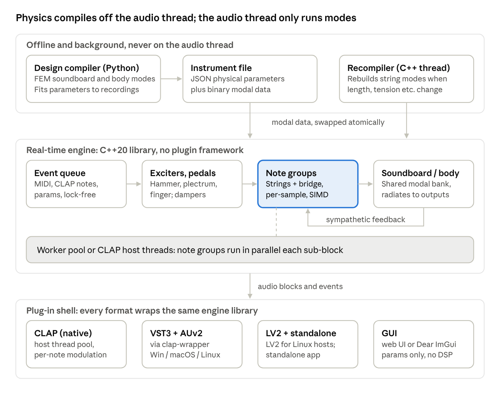
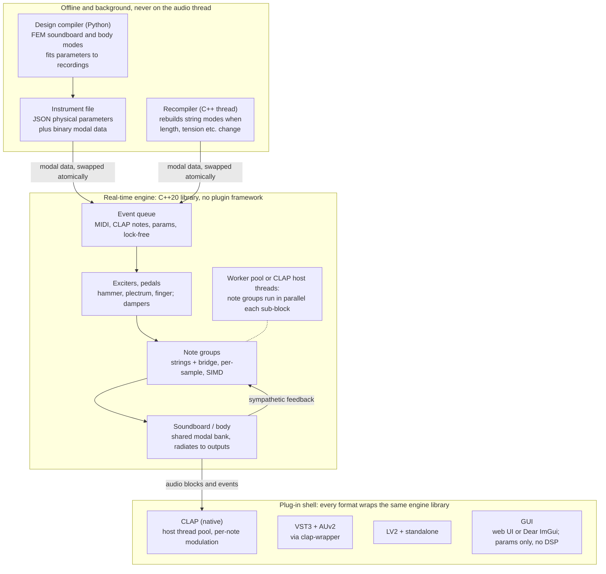
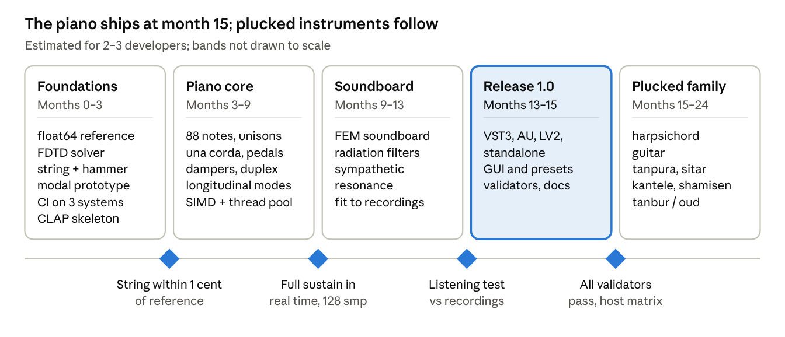

# Real-Time Physical Modelling Piano & Plucked-String Engine — Implementation Plan

Author: Guilherme da Silveira · Dated 2026-10-11 · Status: background plan (PLAN keys). SPEC governs engine behaviour; its Roadmap section is superseded by [phasing-plan.md](phasing-plan.md).

> Canonical copy. Migrated from claude.ai Docs into this repository; edit it here. Planning documents are written and maintained by Opus agents only (see [CLAUDE.md](../../CLAUDE.md)).

## Summary and key decisions

Build one open-source engine whose flagship is a concert grand piano. Guitar, sitar, tanpura, harpsichord and other plucked strings reuse the same core as configurations, not separate products.

- **One engine, not several.** Every target instrument decomposes into the same blocks: stiff strings, an exciter (hammer, plectrum, finger), optional contact barriers (frets, jawari, sawari) and a modal body. Only the flat-bridge instruments add a new solver, and it fits the same modal framework.
- **Numerical core: modal synthesis with exact per-mode parameters** for strings and soundboard/body. Nonlinear parts (hammer felt, collisions, tension modulation) use explicit, energy-stable updates. FDTD is kept for an offline reference solver only.
- **Physical parameters are compiled, not hard-coded.** An offline design compiler turns materials and dimensions into modal data; the real-time engine only runs modes. Editing a material recompiles the affected notes on a background thread.
- **Parallel on the CPU.** SIMD across modes plus a real-time thread pool across string groups. At plugin buffer sizes (64–256 samples) this beats both sequential code and a GPU; GPU compute is reserved for the offline reference solver.
- **Stack:** C++20 core with a SIMD abstraction library, CLAP as the native plugin format, VST3 / AU / standalone through wrappers, LV2 on Linux. CMake and CI builds for Windows, macOS (arm64 + x86-64) and Linux.
- **Piano realism features are first-class:** una corda (continuous hammer shift), half-pedalling, sostenuto, duplex scale, unison detuning, two polarisations, longitudinal waves and sympathetic resonance.
- **Licence:** a permissive licence (MIT or Apache-2.0) for the engine so others can embed it; the plugin GUI layer may carry a copyleft licence if its framework requires one.

## One engine or several

The instruments are compatible: one core covers all of them, so the piano gets priority in scheduling, not a separate codebase. They differ in two loads. The piano has many mostly linear strings sharing one soundboard; flat-bridge instruments have few strings, each with a dense nonlinear contact.

| Instrument | Exciter | Strings simulated | What is special | Extra module beyond the core |
| --- | --- | --- | --- | --- |
| Grand piano | Felt hammer (nonlinear, hysteretic) | About 230 (1–3 per note), coupled through the bridge when dampers lift | Unisons, longitudinal waves and phantom partials, una corda, dampers, duplex scale | None; sets the compute budget |
| Harpsichord | Plectrum with slip-off | 1–3 choirs of about 60 notes | Register switching, buff stop, key-release thump | Plectrum contact |
| Classical / steel guitar | Finger or pick | 6 | Fret, fretboard and stopping-finger collisions; body air cavity | Distributed collision (frets) |
| Sitar | Mizrab plectrum | 6–7 played plus 11–13 sympathetic | Flat jawari bridge, string bending | Distributed bridge contact |
| Tanpura | Finger pluck | 4 | Jawari bridge plus cotton thread | Bridge and thread contact |
| Kantele | Finger | 5 (traditional) or more | Bridgeless pin termination, knotted end: second-order nonlinearity and beating | Tension modulation |
| Shamisen / biwa | Bachi plectrum | 3–4 | Sawari contact near the nut; skin membrane body | Short contact plus membrane body |
| Tanbur / oud | Plectrum | Several courses | Tension modulation, sympathetic courses | Tension modulation |

Two facts back the single-engine choice. A [real-time tanpura model](https://dafx.de/paper-archive/details/DYDzhePW7F9YEWfoZSF0dQ) already combines modal string dynamics with bridge and thread contact in a provably stable scheme, so contact lives inside the modal framework. Commercially, [Pianoteq](https://www.zynthian.org/engines/_engine-list/engine-pianoteq) runs pianos, a harpsichord and a concert harp on one physical model and [added a classical guitar in v8](https://nantelmusic.com/products/modartt-pianoteq-8-standard-physically-modeled-piano-with-full-editing).

Consequence for the plan: the piano drives the performance design (threading, SIMD, voice management); the plucked family drives the nonlinear-solver design. Both are built into the core from the start, but the piano ships first.

## Piano physical model and exposed parameters

The piano follows the chain key → hammer → unison strings → bridge → soundboard → air, as in the [Chabassier–Chaigne–Joly grand piano model](https://hal-ensta-paris.archives-ouvertes.fr/hal-00873089). Every user-facing control is a physical quantity in SI units; the design compiler converts it to modal data.

| Component | User-facing parameters (units) | How the model uses them |
| --- | --- | --- |
| Key and action | Key velocity map, let-off distance (mm), repetition | Sets hammer velocity at contact; optional lumped action model later |
| Hammer | Mass (g), felt stiffness K and exponent p, hysteresis (hereditary amplitude, relaxation time), contact width (mm), strike point (fraction of length) | Nonlinear hysteretic contact force on each struck string |
| Una corda / soft pedal | Shift s from 0 to 1 (grand); hammer-rail travel (upright) | Weights of the struck strings, plus felt stiffness at the shifted contact zone; upright reduces hammer velocity |
| Strings | Speaking length (m), core and winding diameters (mm), density (kg/m³), Young's modulus (GPa), tension (N), unison detune (cents), duplex segment lengths | Modal frequencies with stiffness, two transverse polarisations, longitudinal modes, frequency-dependent losses |
| Bridge and soundboard | Plate outline and thickness map (mm), wood constants (E\_L, E\_R, G\_LR in GPa, density), grain angle, rib count / spacing / section, bridge height and position, crown | Soundboard modes, damping and mode shapes at each string's bridge point; radiation per mode |
| Dampers and pedals | Damper felt damping, lift timing, half-pedal depth, sostenuto latch | Time-varying damping per string; which strings are free for sympathetic resonance |
| Radiation and room | Lid angle, listener / microphone positions | Per-mode radiation filters to each output channel |
| Tuning | Temperament, octave stretch, per-note detune | Fine adjustment of tension per string |

String stiffness enters through the inharmonicity coefficient B, so length, diameter, modulus and tension all move the partials directly:

```math
f_n = n f_0 \sqrt{1 + B n^2}, \qquad B = \frac{\pi^3 E d^4}{64\, T L^2}
```

**Una corda.** Weinreich's coupled-string theory is the basis, and [Miranda Valiente et al. (2024)](https://eprints.soton.ac.uk/499445) show the model to follow: with una corda the passive string's bridge force grows over time and contributes less overall. The shift is continuous, so half-una-corda works, and the felt-zone change is a separate parameter because worn and unworn felt differ.

**Default data.** Factory presets start from published Steinway D parameters ([Chabassier & Duruflé](https://viennatalk2015.mdw.ac.at/proceedings/ViennaTalk2015_submission_19.pdf)) and hammer data from [Stulov's measurements](https://kirj.ee/wp-content/plugins/kirj/pub/eng-4-2000-259-267_20230201172612.pdf), where felt parameters vary with string diameter. Soundboard modal bases can be generated with the open-source [MAESSTRO](https://hal-ensta-paris.archives-ouvertes.fr/hal-03409789) toolchain, which takes soundboard geometry and materials as input.

## Numerical methods for real time

Modal synthesis is the core method, with explicit energy-quadratised updates for every nonlinearity. This gives exact partial frequencies and decay rates, a fixed cost per sample and no iterative solver in the audio thread.

| Method | Partial accuracy | Nonlinearities and contact | Cost and parallelism | Role here |
| --- | --- | --- | --- | --- |
| Modal (exact per-mode recursion) | Exact frequency and damping per mode; no numerical dispersion | Via projection of contact forces onto modes; proven for tanpura bridges | Linear in mode count; independent modes map directly to SIMD lanes | Real-time core for strings, soundboard and bodies |
| FDTD (finite differences) | Numerical dispersion; stiff strings need fine grids or oversampling | Most general; energy-conserving schemes well developed | Stencil updates; good on GPU, weaker at small audio blocks | Offline reference solver and validation |
| Digital waveguide | Exact only with dispersion filters; per-partial losses hard | Point nonlinearities only; distributed contact awkward | Cheapest per string | Not used in the core; optional low-CPU mode |
| Neural / differentiable DSP | Learned from recordings | Implicit | Inference cost; physically interpretable only if physics-guided | Offline parameter fitting, not synthesis |

**Nonlinear parts.** Each nonlinearity uses a Scalar Auxiliary Variable (SAV) or invariant-energy-quadratisation scheme, which avoids iterative solvers and keeps cost per sample fixed ([Ducceschi, convergence and relaxation for modal SAV](https://www.research.ed.ac.uk/en/publications/convergence-analysis-and-relaxation-techniques-for-modal-scalar-a/)). The known weakness is drift of the auxiliary variable; the plan adopts published fixes such as [power-balanced drift regulation (DAFx 2025)](https://dafx25.dii.univpm.it/wp-content/uploads/2025/09/DAFx25_paper_24.pdf).

- **Hammer–string contact:** lumped hammer mass, power-law felt with hysteresis, contact force spread over the hammer width and projected onto each struck string's modes.
- **Geometric string nonlinearity (phantom partials, pitch glide):** two tiers. Default: longitudinal modes driven by the transverse stretching term. High-quality: the geometrically exact model, which [Ducceschi, Bilbao and Webb](https://cris.unibo.it/handle/11585/883682) report running below real time in C++ for typical struck strings.
- **Collisions (frets, fingers, jawari, sawari, dampers):** one-sided power-law potentials with explicit energy-stable updates, including contact damping and dry friction as in [van Walstijn (2024)](https://www.qub.ac.uk/research-centres/sarc/news/210624collisionsinmusicalinstruments.html).
- **String–bridge–soundboard coupling:** exact per-sample coupling inside each note group through a small linear solve; across groups, coupling through the shared soundboard state (see Computation strategy).

**Precision and sample rate.** Mode states run in float32 using a rotation (complex one-pole) form, which stays accurate for high-Q, low-frequency modes; the design compiler and energy monitors use float64. Modal parts need no oversampling because only modes below Nyquist exist; hard collisions get an optional 2× oversampled contact stage. Every scheme is validated against a float64 FDTD reference.

## Computation strategy

Parallel computation wins, in two layers: SIMD across the modes of each note, and a real-time worker pool across notes. Only the per-sample coupling inside one note stays sequential. Accuracy does not depend on the thread count, because every reduction runs in a fixed order and output is bit-identical for 1 or N threads.

**Budget (estimate).** Counted for a modern concert grand at 48 kHz, two polarisations per string, about 8 longitudinal modes per string, a 2,000–3,000-mode soundboard and about 10 floating-point operations per mode per sample. The inharmonicity profile across the keys is approximate.

| Scenario | Active modes | Compute |
| --- | --- | --- |
| 10 mid-register notes, dampers down | About 1,600 | Under 1 GFLOP/s |
| Full sustain, all 228 strings ringing, partials to 12 kHz | About 21,000 | About 10 GFLOP/s |
| Same, partials to 20 kHz | About 29,000 | About 14 GFLOP/s |

The bottom 28 keys hold about 58% of all modes, so load balancing must weight bass notes. The whole-piano state is about 400 KB, which fits in cache. Ordinary playing fits on one core; the full-sustain worst case needs a few cores at realistic SIMD efficiency. Strings whose energy falls below −100 dB go to sleep and wake when the soundboard excites them.

**Parallel structure.**

1. **Note group** = one note's 1–3 strings × 2 polarisations, its longitudinal modes and a lumped bridge admittance. These are coupled exactly every sample: sequential in time, SIMD across modes (8 or 16 lanes), and small enough to stay in L1 cache.
2. **Sub-blocks** of 16–32 samples: note groups are independent within a sub-block and are spread over workers, balanced by mode count.
3. **Shared soundboard**: the summed bridge forces drive the full soundboard bank. Its bridge velocities feed back into undamped strings at the next sub-block, which produces sympathetic resonance with at most 0.7 ms of coupling delay at 48 kHz; an energy bound on the coupling keeps it passive.
4. **Radiation**: soundboard modes map to output channels through per-mode radiation weights.

**Threads.** First choice is the host's own pool through CLAP's thread-pool extension, which [lets host and plug-in share multicore work](https://u-he.com/fwd/clap/). Otherwise the engine runs its own pool: workers join the host's audio workgroup on macOS, register as MMCSS "Pro Audio" on Windows and get real-time scheduling through rtkit / PipeWire on Linux. No locks or allocations on the audio path, a spin-then-yield barrier per sub-block, and a user setting where 1 thread means fully sequential.

**SIMD.** Structure-of-arrays layout with runtime dispatch: SSE4.2 / AVX2 / AVX-512 on x86-64 and NEON on arm64. Denormals are flushed to zero.

**GPU stance.** No GPU in the real-time path for version 1. Per-buffer dispatch and synchronisation cost too much at 1–5 ms buffers, and no single compute API covers all three systems well (CUDA is NVIDIA-only, Metal is Apple-only). Recent work [benchmarks CPU, GPU and FPGA](https://public-pages-files-2025.frontiersin.org/journals/signal-processing/articles/10.3389/frsip.2025.1715792/epub) for modal synthesis on mode count, latency and resources; the plan reruns that comparison before version 2. The GPU is used for the offline reference solver and the design compiler's eigen-solves.

## Software architecture

Three layers: an offline design compiler, a framework-free real-time engine library, and a thin plug-in shell. Physics is compiled before it reaches the audio thread, so edits to materials or dimensions never block playback.





A physical edit goes to the recompiler, which rebuilds the affected modal data and swaps it in atomically at a block boundary. String modes rebuild in C++ from closed-form formulas; soundboard and body modes come only from the offline design compiler. Note groups push bridge forces to the soundboard each sample, and the soundboard feeds the undamped strings at the next sub-block.

## Technology stack

C++20 for everything that runs in real time, Python for the offline design compiler, and CLAP as the native plugin format. Every core dependency carries a permissive licence, so the engine can be MIT or Apache-2.0.

| Layer | Choice | Why |
| --- | --- | --- |
| Engine language | C++20 (Clang / AppleClang, MSVC or clang-cl, GCC) | Best vectorising compilers on all three systems; CLAP, VST3 and AU SDKs are native C/C++ |
| SIMD | Google Highway or xsimd, with runtime CPU dispatch | One source for SSE4.2, AVX2, AVX-512 and NEON |
| Concurrency | Own fork-join pool, lock-free SPSC queues for parameter and MIDI hand-off | No locks or allocations on the audio path |
| Native plugin API | [CLAP](https://u-he.com/fwd/clap/) (MIT licence) | Host thread pool, per-note modulation, single sample-accurate event queue |
| Other formats | VST3 and AUv2 through [clap-wrapper](https://github.com/CrushedPixel/rust-clap-first-example); LV2 on Linux | The [VST 3 SDK is MIT-licensed from version 3.8](https://sonicstate.com/news/2025/10/30/vst-3-now-available-under-mit-license) (Oct 2025) |
| Standalone app | clap-wrapper standalone, or RtAudio + RtMidi | Runs without a DAW on all three systems |
| GUI | Web UI in a native WebView, or Dear ImGui | Keeps the whole project permissive and separate from the DSP |
| Design compiler | Python with NumPy / SciPy; Gmsh plus an open FEM solver for soundboard and body eigen-modes; JAX for fitting to recordings | Fast iteration on physics; never runs on the audio thread |
| Instrument files | Versioned JSON for physical parameters plus binary modal blobs | Human-editable presets; fast loading |
| Build and CI | CMake presets, CPM.cmake or vcpkg; GitHub Actions matrix for Windows, macOS universal (arm64 + x86-64) and Linux | One build description for all targets |
| Tests | doctest or Catch2; clap-validator, pluginval, auval and Steinberg's validator | Catches host-compatibility bugs before release |

**JUCE as an alternative.** JUCE gives a mature GUI and wrappers, but its modules are [dual-licensed under AGPLv3 or a commercial licence](https://git.efi.th-nuernberg.de/gitea/depperschmidch101180/main_crystalizereq/src/commit/51ec8e00cfde3c9f910af0eedf16d1ff8547ddc0/CrystalizerEQ/JUCE/LICENSE.md). Using it would make the plugin AGPLv3; keep the engine library free of JUCE either way.

**Rust as an alternative.** Rust with nih-plug offers memory safety and CLAP / VST3 export. C++ is preferred here because the SIMD libraries, AU support and reference physics code are all C/C++.

**Not in version 1:** AAX (Pro Tools) and AUv3 / iOS, which need closed SDKs or app-store distribution.

## Extension to plucked instruments

Each plucked instrument is a new configuration of existing blocks plus at most one new module. The order follows how much each reuses: harpsichord first (keyboard and soundboard already exist), then guitar, tanpura, sitar and the rest.

| Instrument | New module | Body | Starting references |
| --- | --- | --- | --- |
| Harpsichord | Plectrum contact with slip-off; register and buff-stop switching | Soundboard through the piano pipeline | [Perng, Smith & Rossing plectrum model](https://labs.sonicfield.org/library/sound-synthesis-of-the-harpsichord-pluck-using-a-physical-plectrum-string-intera); [Välimäki et al. (2004)](https://asp-eurasipjournals.springeropen.com/articles/10.1155/S111086570440211X) |
| Classical / steel guitar | Finger or pick pluck; fretboard, fret and stopping-finger collisions | FE modes of the braced top, back and air cavity | [Bilbao & Torin (2014)](https://dafx.de/paper-archive/details/VW3ckMHQUdwpOen-KsadwA); [real-time guitar (DAFx 2024)](https://dafx.de/paper-archive/2024/papers/DAFx24_paper_50.pdf); [Derveaux et al.](https://researchportal.ip-paris.fr/en/publications/time-domain-simulation-of-a-guitar-model-and-method/) |
| Tanpura | Distributed bridge contact plus cotton thread; tension modulation | Gourd and top modes | [van Walstijn, Bridges & Mehes (2016)](https://dafx.de/paper-archive/details/DYDzhePW7F9YEWfoZSF0dQ); [tension modulation (DAFx 2017)](https://www.qub.ac.uk/research-centres/sarc/news/SARCResearchPresentedatDAFx2017-1.html) |
| Sitar | Same jawari contact; sympathetic taraf strings reuse the piano's sympathetic coupling; meend as time-varying tension | Gourd and top modes | [Kartofelev et al. (2013)](https://www.tud.ttu.ee/web/dmitri.kartofelev/publications/smacsmc2013.pdf); [van Walstijn & Chatziioannou (2014)](https://pureadmin.qub.ac.uk/ws/files/10528686/isma14a.pdf) |
| Kantele | Bridgeless pin termination; second-order nonlinearity | Box modes | [Erkut et al. (2002)](https://labs.sonicfield.org/library/acoustical-analysis-and-model-based-sound-synthesis-of-the-kantele) |
| Shamisen / biwa | Sawari short contact; bachi plectrum | Skin membrane modes | [Taguti (2008)](https://www.jstage.jst.go.jp/article/ast/29/3/29_3_203/_article); [real-time shamisen (SMC 2021)](https://vbn.aau.dk/files/445884956/SMC_2021_paper_41.pdf) |
| Tanbur / oud | Tension modulation; sympathetic courses | Bowl modes | [Model-based tanbur (ICASSP 2000)](https://vbn.aau.dk/da/publications/model-based-sound-synthesis-of-tanbur-a-turkish-long-necked-lute) |

Wood properties matter for every body. Guitar studies show the top's longitudinal and radial elastic constants and relative humidity [dominate soundboard dynamics](https://biblioteca.iqs.edu/en/node/3767), so the design compiler exposes both, as it does for the piano soundboard.

## Validation and testing

Every release passes four gates: physics against a reference solver, sound against measurements, listeners against real instruments, and plugins against hosts. Thresholds below are proposed targets, to be tuned once the first measurements exist.

| Gate | Test | Proposed pass criterion |
| --- | --- | --- |
| Physics | Each module vs the float64 FDTD reference | Lossless energy drift at round-off level; convergence order as derived |
| Physics | Real-time engine vs reference for the same note | Partial frequencies within 1 cent; per-partial decay times within 10% |
| Physics | Soundboard design changes (thickness, rib count, bridge height) | Same direction of change as [Miranda Valiente's parametric study](https://eprints.soton.ac.uk/504922/) and MAESSTRO |
| Sound | Recorded single notes at several velocities, with and without una corda and sustain | Matches inharmonicity, double decay, phantom-partial levels and attack spectrum within measurement spread |
| Sound | Measured bridge mobility of a real soundboard | Modal model within measurement spread up to 2 kHz |
| Listening | MUSHRA and ABX tests with pianists | Not reliably distinguished from recordings for mid-register notes |
| Real time | CPU per scenario from the budget table; 32-, 64- and 128-sample buffers | No dropouts on a mid-range 2024 laptop at 128 samples |
| Real time | Output with 1 vs N threads | Bit-identical |
| Real time | 24-hour sustain-pedal soak | No drift, no denormal stalls, no growth in energy |
| Plugin | clap-validator, pluginval, auval, Steinberg validator in CI | Zero failures |
| Plugin | Host matrix: Reaper, Bitwig, Ableton Live, Logic, Cubase, Ardour | Loads, saves, recalls and renders offline identically |

## Roadmap and milestones

The piano reaches a 1.0 release in about 15 months; the plucked family follows over the next 9. Each phase ends at a gate, and no phase starts before the previous gate passes.

> **Superseded.** This roadmap (with time estimates) is kept for history only. The binding phase structure, with no timing or effort estimates, is [phasing-plan.md](phasing-plan.md) and its machine-readable mirror [phases.yaml](phases.yaml).



The first gate is the cheapest test of the whole approach: if one modal string with a hammer cannot match the float64 reference, the numerical core changes before any piano work starts.

## Risks and open questions

The largest technical risk is the sub-block delay in sympathetic coupling; the largest practical risk is getting good physical parameters for real instruments.

| Risk | Impact | Mitigation |
| --- | --- | --- |
| Sub-block delay in soundboard feedback colours or destabilises sympathetic resonance | Audible artefacts with full sustain | Energy bound on the coupling; 16-sample sub-blocks; A/B against a per-sample reference |
| Auxiliary-variable drift in SAV schemes | Spurious noise or pitch artefacts on loud notes | Drift regulation and relaxation from the published fixes; energy monitors in debug builds |
| Felt, damping and soundboard parameters are hard to measure | Physically plausible but wrong-sounding presets | Fit parameters to recordings, as in [perceptual parameter fitting for piano models](https://hal.archives-ouvertes.fr/hal-00105865), with the differentiable model offline |
| Wood variability between real instruments | Presets match one instrument, not a type | Expose variability as a parameter; calibrate to measured bridge mobility |
| Host and plug-in compete for CPU threads | Dropouts in busy sessions | Prefer the CLAP host thread pool; user thread cap; 1-thread fallback |
| Scope creep across many instruments | Piano ships late | Plucked instruments start only after the piano release gate |
| Prior art and patents on modelling techniques | Legal exposure for an open project | Prior-art review of each technique before release |

**Open questions**

- [ ] Team size and time budget: the roadmap assumes 2–3 developers; confirm.
- [ ] Plugin GUI licence: fully permissive (web UI) or JUCE under AGPLv3?
- [ ] Access to a concert grand and measurement gear for bridge mobility and note recordings.
- [ ] Which plucked instrument follows the harpsichord: guitar or tanpura / sitar?

## References

**Piano models and data**

- [Chabassier, Chaigne & Joly — Modeling and simulation of a grand piano](https://hal-ensta-paris.archives-ouvertes.fr/hal-00873089)
- [Chabassier & Duruflé — Vienna Talk 2015, string parameters](https://viennatalk2015.mdw.ac.at/proceedings/ViennaTalk2015_submission_19.pdf)
- [MAESSTRO 1.0.0 software](https://hal-ensta-paris.archives-ouvertes.fr/hal-03409789)
- [Miranda Valiente — Modelling of sound generation in pianos (PhD, 2025)](https://eprints.soton.ac.uk/504922/)
- [Miranda Valiente et al. — Modelling the una-corda effect in pianos (2024)](https://eprints.soton.ac.uk/499445)
- [Stulov — Piano hammer testing device](https://kirj.ee/wp-content/plugins/kirj/pub/eng-4-2000-259-267_20230201172612.pdf)
- [Bensa et al. — Parameter fitting for piano sound synthesis](https://hal.archives-ouvertes.fr/hal-00105865)

**Numerical methods**

- [Ducceschi — Convergence analysis and relaxation for modal SAV methods](https://www.research.ed.ac.uk/en/publications/convergence-analysis-and-relaxation-techniques-for-modal-scalar-a/)
- [Power-balanced drift regulation for SAV methods (DAFx 2025)](https://dafx25.dii.univpm.it/wp-content/uploads/2025/09/DAFx25_paper_24.pdf)
- [Ducceschi, Bilbao & Webb — Real-time struck piano string with geometrically exact nonlinearity](https://cris.unibo.it/handle/11585/883682)
- [van Walstijn — Explicit energy-stable scheme for collisions with damping and friction (2024)](https://www.qub.ac.uk/research-centres/sarc/news/210624collisionsinmusicalinstruments.html)
- [Editorial: Sound synthesis through physical modeling (Frontiers, 2025)](https://public-pages-files-2025.frontiersin.org/journals/signal-processing/articles/10.3389/frsip.2025.1715792/epub)

**Plucked instruments**

- [van Walstijn, Bridges & Mehes — Real-time tanpura model](https://dafx.de/paper-archive/details/DYDzhePW7F9YEWfoZSF0dQ)
- [van Walstijn & Chatziioannou — Numerical simulation of tanpura string vibrations](https://pureadmin.qub.ac.uk/ws/files/10528686/isma14a.pdf)
- [Kartofelev et al. — String terminated against a bridge](https://www.tud.ttu.ee/web/dmitri.kartofelev/publications/smacsmc2013.pdf)
- [Bilbao & Torin — String/barrier collisions: the fretboard](https://dafx.de/paper-archive/details/VW3ckMHQUdwpOen-KsadwA)
- [Real-time guitar synthesis (DAFx 2024)](https://dafx.de/paper-archive/2024/papers/DAFx24_paper_50.pdf)
- [Derveaux et al. — Time-domain simulation of a guitar](https://researchportal.ip-paris.fr/en/publications/time-domain-simulation-of-a-guitar-model-and-method/)
- [Viala et al. — Spanish guitar soundboard model](https://biblioteca.iqs.edu/en/node/3767)
- [Välimäki et al. — Harpsichord synthesis](https://asp-eurasipjournals.springeropen.com/articles/10.1155/S111086570440211X)
- [Perng, Smith & Rossing — Harpsichord plectrum model](https://labs.sonicfield.org/library/sound-synthesis-of-the-harpsichord-pluck-using-a-physical-plectrum-string-intera)
- [Erkut et al. — Kantele](https://labs.sonicfield.org/library/acoustical-analysis-and-model-based-sound-synthesis-of-the-kantele)
- [Taguti — Sawari mechanism](https://www.jstage.jst.go.jp/article/ast/29/3/29_3_203/_article)
- [Real-time shamisen (SMC 2021)](https://vbn.aau.dk/files/445884956/SMC_2021_paper_41.pdf)
- [Model-based tanbur (ICASSP 2000)](https://vbn.aau.dk/da/publications/model-based-sound-synthesis-of-tanbur-a-turkish-long-necked-lute)

**Software and licensing**

- [CLAP (u-he)](https://u-he.com/fwd/clap/)
- [VST 3 now under MIT licence (Sonic State, Oct 2025)](https://sonicstate.com/news/2025/10/30/vst-3-now-available-under-mit-license)
- [clap-wrapper usage example](https://github.com/CrushedPixel/rust-clap-first-example)
- [JUCE licence file (AGPLv3 / commercial)](https://git.efi.th-nuernberg.de/gitea/depperschmidch101180/main_crystalizereq/src/commit/51ec8e00cfde3c9f910af0eedf16d1ff8547ddc0/CrystalizerEQ/JUCE/LICENSE.md)
- [Pianoteq instrument list](https://www.zynthian.org/engines/_engine-list/engine-pianoteq)
- [Pianoteq 8 classical guitar](https://nantelmusic.com/products/modartt-pianoteq-8-standard-physically-modeled-piano-with-full-editing)
