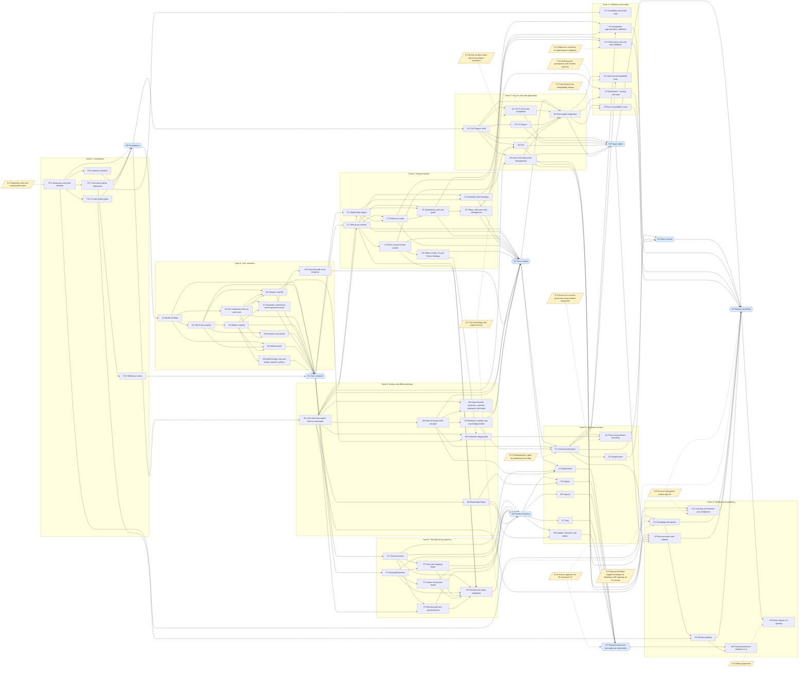

# Phase dependency graph

Generated from [phases.yaml](phases.yaml) by `docs/plan/tools/gen_phase_graph.py`. Do not edit by hand.

Solid arrows: phase or gate dependencies. Dotted arrows: human decisions (see the Decisions section of [phasing-plan.md](phasing-plan.md)). Hexagons are gates.

