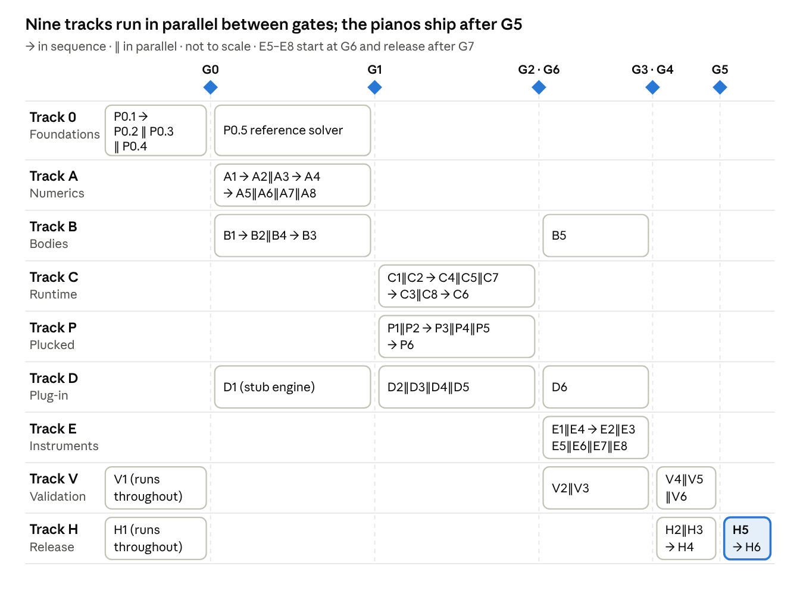

# Implementation Phasing Plan — Physical Modelling Engine

Author: Guilherme da Silveira · Dated 2026-10-11 · Status: normative for phasing; drives the orchestrator together with [phases.yaml](phases.yaml).

> Canonical copy. Migrated from claude.ai Docs into this repository; edit it here. Planning documents are written and maintained by Opus agents only (see [CLAUDE.md](../../CLAUDE.md)).

## How to use this plan

This plan is the work breakdown an orchestrator turns into agent briefs: every phase card states what to build, what it depends on, what it must produce and which tests prove it done. It contains no durations or effort estimates. When every phase and gate has passed, the software is built, validated and published.

**Source documents and reference keys.** Phase cards cite sections by key; agents MUST read every cited section before starting.

| Key | Document and section |
| --- | --- |
| SPEC-CONV | [Engine specification](engine-specification.md) — Scope, conventions and notation |
| SPEC-GLANCE | Engine specification — Engine at a glance |
| SPEC-OSC | Engine specification — The modal oscillator |
| SPEC-STR | Engine specification — Stiff string model |
| SPEC-BRG | Engine specification — Bridge coupling |
| SPEC-BODY | Engine specification — Soundboard and bodies |
| SPEC-NL | Engine specification — Nonlinear framework |
| SPEC-HAM | Engine specification — Hammer and action |
| SPEC-DMP | Engine specification — Dampers and pedals |
| SPEC-GEO | Engine specification — Geometric nonlinearity and longitudinal waves |
| SPEC-PLK | Engine specification — Plucked exciters and barriers |
| SPEC-INST | Engine specification — Instrument definitions |
| SPEC-EXEC | Engine specification — Execution order |
| SPEC-API | Engine specification — Engine interfaces |
| SPEC-ORC | Engine specification — Verification oracles |
| PLAN-COMP | [Implementation plan](implementation-plan.md) — Computation strategy (budget table) |
| PLAN-ARCH | Implementation plan — Software architecture |
| PLAN-STACK | Implementation plan — Technology stack |
| PLAN-VAL | Implementation plan — Validation and testing |
| PLAN-RISK | Implementation plan — Risks and open questions |

**Precedence.** SPEC governs engine behaviour. This document governs phasing, outputs and tests, and replaces the implementation plan's roadmap section. PLAN-STACK applies wherever the Software guidelines below do not say otherwise.

**Phase card format.** Every phase card has these fields:

- **ID and name**, for example A2 Stiff string compiler.
- **Mode**: sequential (after named phases) or parallel (alongside named phases).
- **Depends on**: phases or gates that MUST be complete before the phase starts.
- **Description**: what the phase delivers and why.
- **Requirements**: numbered, with IDs (A2-R1, A2-R2 …); each is a MUST unless it says SHOULD or MAY.
- **Outputs**: code modules, files and artifacts, with repository paths.
- **Tests**: exit criteria with IDs (A2-T1 …); the test code MUST carry the same ID in its name.
- **References**: SPEC and PLAN keys.

**Orchestration rules.**

1. Start every phase whose dependencies are complete; run independent phases concurrently.
2. A phase is complete only when its definition of done holds (Agent briefs and handoff) and all its tests pass in CI on Windows, macOS and Linux.
3. Gates are checkpoints owned by the orchestrator. A gate passes when every criterion in the Gates section holds; phases that depend on a gate wait for it.
4. Interfaces created in P0.4 are frozen; changes follow the interface change protocol.
5. A phase MAY be split across agents along the module boundaries in its Outputs. One module MUST NOT be edited by two agents at the same time.
6. If a test cannot pass because SPEC is wrong or ambiguous, the agent files a spec issue and stops that item. The orchestrator resolves it, asking a human when needed, and updates SPEC. Agents never deviate silently.
7. Every requirement and test ID MUST be traceable from code, tests and pull requests.
8. [phases.yaml](phases.yaml) is the machine-readable mirror of every phase card and gate; the orchestrator schedules from it and records progress in [docs/status/phase-status.md](../status/phase-status.md). After any plan edit, run `python3 docs/plan/tools/gen_phase_graph.py --check`.
9. Model policy: planning documentation is written by Opus, code by Sonnet (Agent briefs and handoff, Model assignment).

## Phase map

Nine tracks run side by side and synchronise only at gates. The critical path for the piano release is Track 0 → A → C → D6 and E1 → validation → H5; plucked numerics (Track P) run alongside Track C and gate only the plucked instruments.



The full dependency graph (every phase, gate and decision) is generated from [phases.yaml](phases.yaml) into [phase-graph.md](phase-graph.md).

Each bar sits between the gates that bound it: a phase in a bar may start once the gate on its left has passed and its own card's dependencies are met, and the gate on its right waits for it. Phase cards hold the exact dependencies; where the map and a card differ, the card wins.

## Software guidelines

These rules bind every phase and every agent. A phase card may add rules but never relax these.

**Repository layout.** One public monorepo. Paths in phase cards refer to this tree.

```text
/                         LICENSE, README.md, CONTRIBUTING.md, CODEOWNERS, CMakeLists.txt, CMakePresets.json, pyproject.toml
/docs/adr/                architecture decision records, ADR-NNNN-title.md
/docs/dev/                developer notes, one file per module
/docs/user/               user manual sources
/engine/include/pme/      public C++ headers (SPEC-API)
/engine/src/osc/          modal oscillator
/engine/src/string/       stiff string compiler
/engine/src/bridge/       bridge terms, polarisation rotation
/engine/src/body/         local bridge, global body, radiation
/engine/src/nonlinear/    SAV, potentials, dashpots, low-rank solve
/engine/src/exciters/     hammer, pluck pulse, plectrum, finger
/engine/src/dampers/      dampers and pedal logic
/engine/src/barriers/     distributed barriers, frets, jawari, sawari, thread
/engine/src/runtime/      note group loop, events, parameters, sleep/wake, reference mode
/engine/src/sched/        thread pool, platform real-time integration
/engine/src/simd/         vector kernels and dispatch
/engine/tests/            unit, oracle, integration, performance, RT-safety tests
/reference/               independent float64 reference solver
/compiler/pme_compiler/   Python design compiler: schema, plate FEM, radiation, import, fitting
/compiler/tests/
/bindings/python/         Python bindings to engine compile functions and offline render
/plugin/clap/             CLAP plug-in shell
/plugin/wrappers/         clap-wrapper builds: VST3, AUv2, standalone
/plugin/lv2/              LV2 build
/plugin/gui/              GUI
/instruments/             instrument descriptions and blob manifests
/data/                    binary blobs (Git LFS)
/tools/                   render CLI, analysis, benchmarks, validator scripts
/packaging/               installers, signing and notarisation scripts
/.github/workflows/       CI
```

C++ namespace `pme`; Python package `pme_compiler`.

**Languages and dependencies.**

- Engine, reference solver and plug-in: C++20, compiled with Clang / AppleClang, MSVC or clang-cl, and GCC.
- SIMD: Google Highway with runtime dispatch (SSE4.2, AVX2, AVX-512, NEON) by default, recorded as ADR-0001.
- Design compiler: Python 3.12 or later with NumPy, SciPy, Gmsh, scikit-fem (plate elements), JAX for fitting, pytest. FEniCSx MAY replace scikit-fem only through an ADR.
- Bindings: nanobind.
- Plug-in: CLAP SDK, clap-wrapper, VST 3 SDK 3.8 or later, LV2. GUI technology per decision D-1.
- C++ dependencies come through CPM.cmake pinned to exact commits; Python dependencies through a lock file. No third-party code enters the repository without a licence record.

**Real-time rules.** Apply to every function reachable from `Engine::process` (SPEC-EXEC):

1. No heap allocation, locks, system calls, exceptions, file or console I/O, or unbounded loops. Such functions are `noexcept`.
2. All memory is allocated in `prepare` or while compiling an instrument, on non-audio threads.
3. Events enter and diagnostics leave through lock-free single-producer single-consumer queues.
4. A compiled instrument is swapped in by atomic pointer exchange; the old one is freed on a non-audio thread.
5. Flush-to-zero and denormals-are-zero are set at `process` entry and on every worker.
6. An RT-safety build replaces global allocation and blocking primitives with versions that abort when called on a thread marked real-time. All integration tests MUST also run under it.

**Numerics rules.**

1. Compile-time quantities in float64; runtime oscillator states in float32 difference form; energy accumulators in float64 (SPEC-CONV, SPEC-OSC).
2. No fast-math or any flag that allows reassociation. FMA contraction is allowed but fixed per build.
3. Output MUST be bit-identical for any thread count on one build. Comparisons across platforms or compilers use tolerances.
4. Every SIMD kernel has a scalar reference implementation, and a parity test on random inputs within 10⁻⁶ relative.
5. Reductions run in the fixed order of SPEC-EXEC.
6. SI units everywhere. Each function that implements a SPEC formula cites it in a comment, for example `// SPEC-OSC difference form`.

**Quality settings and numerical options (decision D-13, owner, 2026-10-12).** When a modelling or numerical choice has viable alternatives, implement each behind a setting instead of picking one and dropping the others, unless they are incompatible. The default is always the fastest option that plays in real time. Engine-wide choices are engine settings (`EngineConfig::quality`, Realtime or HighQuality, and `EngineConfig::numerics`). Per-instrument modelling choices are instrument options in the description. Engine settings are non-automatable configuration: plug-ins persist them in their state and offer them as settings. The definitions and the option table are in SPEC-CONV "Quality and numerical options"; the interface is ICR-0002. A phase that adds an alternative scheme adds its option to that table through the planner.

**Code style.** clang-format and clang-tidy with the repository configuration; Python with ruff and mypy in strict mode. No global mutable state. Public headers contain declarations and documentation only.

**Testing policy.**

| Category | What it covers | Where it runs |
| --- | --- | --- |
| Unit | Each function and class | Every pull request |
| Oracle | Every SPEC-ORC row, named ORC-xx | Every pull request |
| Integration | Offline renders of defined scenarios | Every pull request |
| Golden features | Partial frequencies, decay rates and spectral envelopes of renders, compared within tolerance | Every pull request |
| RT-safety | Integration tests under the RT-safety build | Every pull request |
| Sanitizers | ASan and UBSan on unit and integration tests; TSan on scheduler tests | Nightly |
| Performance | Benchmarks with stored baselines; regressions above 5% fail | Nightly, and on pull requests that touch engine/src |
| Fuzz and soak | Event, parameter and state fuzzing; 24-hour sustain soak | Nightly and before every release |

Engine core line coverage (engine/src excluding platform glue) MUST stay at or above 90%. Golden references are stored as feature files; audio files for listening live in Git LFS.

**CI.** Three workflows: pull request (build, unit, oracle, integration, lint, RT-safety), nightly (sanitizers, performance, fuzz, soak), and release (packaging, signing, publishing). The pull-request matrix covers Windows with MSVC and clang-cl, macOS arm64 plus a universal build, and Linux with GCC and Clang. Required checks protect the main branch.

**Documentation rules.** Public API documented in headers. Each module has docs/dev/\<module>.md naming the SPEC sections it implements. User-facing parameters are documented with physical meaning and units. Every decision not fixed by SPEC or PLAN gets an ADR.

**Branching and versioning.** Trunk-based: main is always releasable. Phase branches are named phase/\<ID>-\<slug>, and pull-request titles start with the phase ID. Releases follow semantic versioning. The instrument file format has its own schema version with migrations.

**Licensing.** Engine, compiler and plug-in are MIT-licensed unless decision D-1 says otherwise. Every source file carries an SPDX header. A software bill of materials lists every third-party component and licence. Each instrument records the provenance and licence of its data. Instrument names contain no trademarks.

## Track 0 — Foundations

Track 0 creates the repository, CI, test tooling, frozen interfaces and an independent reference solver. P0.1 runs first; P0.2, P0.3 and P0.4 then run in parallel; P0.5 starts after P0.3 and runs alongside Tracks A and B. Gate G0 closes the track.

### P0.1 Repository and build skeleton

- **Mode:** sequential, first phase. **Depends on:** decision D-2 (hosting).
- **Description:** the public monorepo with the layout, build presets and governance files every later phase builds on.
- **Requirements:**
  1. P0.1-R1 Create the repository layout from Software guidelines, with one CMake library target per engine module (pme\_osc, pme\_string …) and an aggregate pme\_engine target.
  2. P0.1-R2 CMake presets: debug, release, rt-safety, asan, tsan and coverage, for each of the three systems.
  3. P0.1-R3 Python package pme\_compiler with pyproject.toml, lock file, ruff and mypy configuration.
  4. P0.1-R4 CPM.cmake with exact pins for Highway, doctest, nanobind, CLAP, clap-wrapper, VST 3 SDK and LV2.
  5. P0.1-R5 LICENSE, SPDX headers, CONTRIBUTING.md (phase-ID rules), CODEOWNERS, .clang-format, .clang-tidy, .editorconfig, and .gitattributes routing /data and audio files to Git LFS.
  6. P0.1-R6 ADR template plus ADR-0001 (Highway), ADR-0002 (scikit-fem) and ADR-0003 (dependency pinning).
- **Outputs:** repository tree, CMakeLists.txt, CMakePresets.json, pyproject.toml, docs/adr/.
- **Tests:** P0.1-T1 every preset configures and builds on all three systems with warnings as errors; P0.1-T2 pytest runs an empty suite; P0.1-T3 the SPDX header check passes.
- **References:** PLAN-STACK, PLAN-ARCH.

### P0.2 CI and quality gates

- **Mode:** sequential after P0.1; parallel with P0.3 and P0.4. **Depends on:** P0.1.
- **Description:** pull-request, nightly and release workflows, lint checks and the RT-safety trap library.
- **Requirements:**
  1. P0.2-R1 Pull-request workflow with the matrix from Software guidelines.
  2. P0.2-R2 Nightly workflow with jobs for sanitizers, performance, fuzzing and soak, initially empty.
  3. P0.2-R3 Release workflow triggered by version tags that builds artifacts but does not publish yet.
  4. P0.2-R4 Lint jobs: clang-format, clang-tidy, ruff, mypy and SPDX.
  5. P0.2-R5 RT-safety trap library pme\_rtcheck with `rtcheck::ScopedRealtimeThread`, aborting on allocation or blocking calls inside the scope in the rt-safety build.
  6. P0.2-R6 JUnit test reports, coverage upload and artifact retention.
  7. P0.2-R7 Required checks on main, documented in CONTRIBUTING.md.
- **Outputs:** .github/workflows/pr.yml, nightly.yml, release.yml; tools/ci/; engine/src/rtcheck/.
- **Tests:** P0.2-T1 a death test proves an allocation inside ScopedRealtimeThread aborts; P0.2-T2 a mis-formatted file fails the pull-request workflow; P0.2-T3 all workflows pass on an empty change.
- **References:** PLAN-STACK.

### P0.3 Test and analysis framework

- **Mode:** sequential after P0.1; parallel with P0.2 and P0.4. **Depends on:** P0.1.
- **Description:** test conventions, the oracle registry, signal-analysis tools used by every validation test, golden-feature comparison and the benchmark harness.
- **Requirements:**
  1. P0.3-R1 doctest integration; test names begin with their requirement or test ID.
  2. P0.3-R2 Oracle registry engine/tests/oracles.md mapping each SPEC-ORC row to an ID (table below), with status and owning phase.
  3. P0.3-R3 Analysis library in C++ with a Python mirror: partial tracking (frequency and amplitude envelope), decay-rate and T60 fitting, inharmonicity (B) fitting, contact-time measurement, spectral envelope, energy accounting.
  4. P0.3-R4 Golden-feature file format (JSON) and a comparator with per-feature tolerances.
  5. P0.3-R5 WAV reading and writing for tests and tools (never linked into the engine).
  6. P0.3-R6 Benchmark harness with JSON output and the 5% regression rule.
- **Oracle IDs** (SPEC-ORC row order):

| ID | Oracle | ID | Oracle |
| --- | --- | --- | --- |
| ORC-01 | Oscillator accuracy | ORC-11 | Longitudinal forcing |
| ORC-02 | Oscillator energy | ORC-12 | Tension modulation |
| ORC-03 | Stiff-string frequencies | ORC-13 | Damper (diagonal) |
| ORC-04 | Tension for pitch | ORC-14 | Fretted pitch |
| ORC-05 | Window shape | ORC-15 | Collision passivity |
| ORC-06 | Bridge damping | ORC-16 | Sample-rate independence |
| ORC-07 | Unison coupling | ORC-17 | Sympathetic approximation |
| ORC-08 | Impact time | ORC-18 | Determinism |
| ORC-09 | Hammer–string energy | ORC-19 | Una corda aftersound |
| ORC-10 | Triangle pluck |  |  |

- **Outputs:** engine/tests/framework/, engine/tests/oracles.md, tools/analysis/ (C++ and Python), tools/bench/.
- **Tests:** P0.3-T1 the analysis tools recover frequencies within 0.01 cent and decay rates within 0.5% from synthetic sums of damped sinusoids; P0.3-T2 the comparator passes identical features and flags a 1% decay change; P0.3-T3 the benchmark harness flags a synthetic 10% regression.
- **References:** SPEC-ORC, PLAN-VAL.

### P0.4 Interface skeleton

- **Mode:** sequential after P0.1; parallel with P0.2 and P0.3. **Depends on:** P0.1.
- **Description:** every type and function of SPEC-API declared, documented and stubbed, then frozen so that all tracks can work in parallel against the same interfaces.
- **Requirements:**
  1. P0.4-R1 Declare every struct, enum and function of SPEC-API in engine/include/pme/, with documentation citing SPEC keys.
  2. P0.4-R2 Headers split by module: osc, string, bridge, body, nonlinear, exciters, dampers, barriers, instrument, engine, events, params, diagnostics.
  3. P0.4-R3 Stubs compile and return a NotImplemented status; real-time stubs output silence and never throw.
  4. P0.4-R4 Parameter registry: stable numeric IDs, names, units, ranges and class (continuous or structural), with a generated params.json for GUI and documentation.
  5. P0.4-R5 Event structures with sample offsets, matching the SPEC-API events table.
  6. P0.4-R6 Tag interfaces-v1; source compatibility holds within a major version; ABI is not promised.
- **Outputs:** engine/include/pme/*.hpp, engine/src/*/stub sources, params.json, docs/dev/interfaces.md.
- **Tests:** P0.4-T1 each header compiles on its own with all compilers; P0.4-T2 the stub Engine processes silence in the rt-safety build without allocating; P0.4-T3 parameter IDs are unique, units are non-empty and ranges are valid.
- **References:** SPEC-API, SPEC-EXEC.

### P0.5 Reference solver

- **Mode:** sequential after P0.3; parallel with Tracks A and B. **Depends on:** P0.3.
- **Description:** an independent float64 time-domain solver that validates the engine. It shares only description structures and the analysis library with the engine, never numerical code.
- **Requirements:**
  1. P0.5-R1 Stiff damped string with an energy-conserving finite-difference scheme and configurable grid.
  2. P0.5-R2 Hammer contact with an iterative (Newton) energy-conserving scheme, deliberately different from the engine's SAV method.
  3. P0.5-R3 Bridge as a lumped mass–spring–dashpot or a conductance, shared by several strings, with both polarisations.
  4. P0.5-R4 Finite-difference orthotropic Kirchhoff plate on a rectangle, coupled to strings at bridge points, with axis-parallel ribs modelled as beams (follow-up P0.5-ribs, added 2026-10-12 for B2-T4).
  5. P0.5-R5 Distributed string–barrier collision (penalty potential, Newton solve).
  6. P0.5-R6 Tension modulation and longitudinal waves (iterative scheme).
  7. P0.5-R7 Grid-refinement and energy-monitor tools; Python bindings and a CLI that render scenarios to features and WAV.
- **Outputs:** reference/, reference/README.md, tools/reference-cli.
- **Tests:** P0.5-T1 string frequencies converge at the scheme's order to the analytic stiff-string values; P0.5-T2 lossless energy is conserved to 10⁻¹² relative per step; P0.5-T3 hammer–wall contact time matches the analytic value within 0.1% on a fine grid; P0.5-T4 simply supported rectangular plate modes match the analytic orthotropic values within 0.1%.
- **References:** SPEC-STR, SPEC-BRG, SPEC-HAM, SPEC-BODY, SPEC-PLK, SPEC-GEO, PLAN-VAL.

## Track A — Core numerics

Track A implements the numerical building blocks of SPEC as tested library code, with no runtime scheduling yet. A1 comes first; A2 and A3 run in parallel; A4 follows A2; A5, A6 and A7 run in parallel; A8 runs alongside A5–A7; A9 (the second bridge scheme, D-13) follows A4 and runs alongside A5, A7 and A8. Gate G1 closes the track. A10 (the geometrically exact tier, D-13) follows A7 and closes before G2.

### A1 Modal oscillator

- **Mode:** first phase of Track A; parallel with B1. **Depends on:** G0.
- **Description:** the discrete oscillator every mode in the engine uses, with float64 coefficient compilation and a structure-of-arrays mode bank.
- **Requirements:**
  1. A1-R1 `compileOscillator` exactly as SPEC-OSC: σ̂Δt = tanh(σΔt) and the cancellation-free ω̂²Δt² formula, in float64.
  2. A1-R2 Bandwidth rule: reject modes with ω\_dΔt > 0.95π, above f\_max, or overdamped.
  3. A1-R3 `ModeBank`: 64-byte-aligned arrays q, u, β, κ, γ (float32) and ω̂², σ̂ (float64), with a scalar difference-form update taking an explicit force vector.
  4. A1-R4 Derived quantities: half-step velocity, centred velocity, centred acceleration.
  5. A1-R5 Discrete energy and energy balance in float64.
  6. A1-R6 Coefficient ramp utility implementing the 0.1%-per-sub-block rule.
- **Outputs:** engine/src/osc/, docs/dev/osc.md.
- **Tests:** ORC-01; ORC-02; A1-T1 coefficients agree with a 50-digit reference within 10⁻¹⁴ relative for ωΔt from 10⁻⁴ to 0.95π and σΔt from 0 to 0.1; A1-T2 bandwidth rejections at 44.1, 48 and 96 kHz; A1-T3 a 1% frequency ramp over one sub-block tracks the analytic chirp phase within 0.1%.
- **References:** SPEC-OSC, SPEC-CONV.

### A2 Stiff string compiler

- **Mode:** sequential after A1; parallel with A3. **Depends on:** A1.
- **Description:** turns string geometry, materials, tuning and losses into a mode table, oscillator coefficients and shape vectors.
- **Requirements:**
  1. A2-R1 Wound-string ρA and EI formulas, including packing factor and ε\_w.
  2. A2-R2 Closed-form tension for pitch; tuning curve = equal temperament plus stretch plus unison detune.
  3. A2-R3 Pinned frequencies, and clamped ends with Fletcher's correction.
  4. A2-R4 Losses b₁, b₂, b₃ with an optional per-partial override table.
  5. A2-R5 Truncation by the bandwidth rule; two polarisations with horizontal detune.
  6. A2-R6 Shape vectors φ̄ for point, rectangular and raised-cosine windows at registered points, computed in float64 and stored float32.
  7. A2-R7 Rear and duplex segments (BridgeEnd At0) with mute ratio.
- **Outputs:** engine/src/string/, docs/dev/string.md.
- **Tests:** ORC-03; ORC-04; ORC-05; A2-T1 wound-string mass and stiffness unit tests; A2-T2 mode counts match the bandwidth rule at 44.1, 48 and 96 kHz; A2-T3 against P0.5, a freely vibrating stiff string matches partial frequencies within 0.05 cent and decay rates within 1%.
- **References:** SPEC-STR.

### A3 SAV framework and low-rank solve

- **Mode:** sequential after A1; parallel with A2. **Depends on:** A1.
- **Description:** the generic nonlinear update used by hammers, plucks, dampers, barriers and tension modulation.
- **Requirements:**
  1. A3-R1 `Potential` interface (value, gradient) and segment coordinate stacking (modes plus lumped coordinates with masses).
  2. A3-R2 `savStep` per SPEC-NL: g evaluation, half-step ψ, explicit forces, dashpot pairs.
  3. A3-R3 Woodbury solve: closed form for r = 1; a small dense solve in float64 for r ≤ 4.
  4. A3-R4 Skip rule, reset-at-separation rule and persistent-contact drift regulation (power-balanced regulation, or the SPEC relaxation fallback).
  5. A3-R5 Diagnostics counters for resets and drift corrections.
- **Outputs:** engine/src/nonlinear/, docs/dev/nonlinear.md.
- **Tests:** ORC-08 with a rigid-wall test potential; A3-T1 Woodbury result equals a dense solve within 10⁻¹² on random systems (float64 build); A3-T2 a quartic test potential across many modes conserves energy within 10⁻¹⁰ (float64); A3-T3 any dashpot makes energy non-increasing; A3-T4 the reset rule fires on separation and never raises energy.
- **References:** SPEC-NL.

### A4 Bridge coupling

- **Mode:** sequential after A2. **Depends on:** A2.
- **Description:** strings on a moving bridge, with pluggable bridge models, unison sharing and polarisation rotation.
- **Requirements:**
  1. A4-R1 `compileBridgeTerms` for both bridge ends; `bridgeForce` as one dot product plus the T/L term.
  2. A4-R2 `BridgePoint` component implementing the SPEC-BRG coupling order, with pluggable models: conductance, mass–spring–damper, and the modal-set interface used by B3.
  3. A4-R3 Unison sharing of one bridge point by several segments.
  4. A4-R4 Polarisation rotation θ\_b and horizontal conductance G\_h.
  5. A4-R5 Hooks for w\_ext (sympathetic input) and for κ\_L, κ\_T contributions (wired in A7).
- **Outputs:** engine/src/bridge/, docs/dev/bridge.md.
- **Tests:** ORC-06; ORC-07; A4-T1 strings plus a lossless mass–spring bridge show no secular energy growth over 10⁶ samples and relative deviation below 10⁻⁶; A4-T2 a mass-like bridge shifts partials as Δω ≈ −2 f₀ Z₀ Im Y within 2% for Z₀|Y| < 0.01; A4-T3 against P0.5, two strings on a mass–spring–damper bridge match partial frequencies within 0.05 cent and decay rates within 2%.
- **References:** SPEC-BRG.

### A5 Hammer and felt

- **Mode:** sequential after A2, A3 and A4; parallel with A6 and A7. **Depends on:** A2, A3, A4.
- **Description:** the piano exciter: velocity map, multi-string felt contact, dissipation, release, repetition and una corda.
- **Requirements:**
  1. A5-R1 Velocity map and launch at a gap of v\_HΔt, with no added latency.
  2. A5-R2 `HammerPotential` over all struck strings with windows and approach sign s\_E.
  3. A5-R3 Hunt–Crossley dashpots per struck string; Stulov hereditary felt as an option.
  4. A5-R4 Release and check at d\_check; repetition while in flight.
  5. A5-R5 Una corda map: strike weights, felt-zone stiffness and exponent; upright soft pedal as velocity scaling.
  6. A5-R6 Flexible shank as one extra oscillator (SPEC-HAM "Flexible shank"), selected per instrument by `HammerParams::shank`; absent = rigid hammer (D-13; amended 2026-10-12 from MAY).
  7. A5-R7 Diagnostics: contact duration and peak force per strike.
- **Outputs:** engine/src/exciters/hammer\*, docs/dev/hammer.md.
- **Tests:** ORC-09; ORC-19; A5-T1 contact time scales as v^((1−p)/(1+p)) within 2% against a rigid wall; A5-T2 against P0.5 with elastic felt, peak force and contact duration within 2%; A5-T3 una corda weights and felt-zone values match SPEC-HAM tables; A5-T4 re-launching a hammer in flight keeps its position continuous.
- **References:** SPEC-HAM, SPEC-NL.

### A6 Dampers and pedals

- **Mode:** sequential after A2; parallel with A5 and A7. **Depends on:** A2, A3.
- **Description:** damper felt models and the pedal and key logic that drives them.
- **Requirements:**
  1. A6-R1 Diagonal damper model with ramped coefficient refresh.
  2. A6-R2 Rank-one damper as one spring–dashpot pair in the low-rank solve.
  3. A6-R3 Lift fraction from key and sustain pedal, half-pedal region, η\_d shaping.
  4. A6-R4 τ\_up and τ\_down timing with release velocity.
  5. A6-R5 Sostenuto latch and per-key hasDamper flags.
- **Outputs:** engine/src/dampers/, docs/dev/dampers.md.
- **Tests:** ORC-13; A6-T1 the rank-one damper makes energy decrease monotonically; A6-T2 table-driven tests of key, sustain and sostenuto sequences against expected lift states; A6-T3 damping increases monotonically as pedal depth decreases through the half-pedal region; A6-T4 engagement ramps produce no output step larger than the largest sample-to-sample change of the undamped signal.
- **References:** SPEC-DMP.

### A7 Geometric nonlinearity and longitudinal waves

- **Mode:** sequential after A3 and A4; parallel with A5 and A6. **Depends on:** A3, A4.
- **Description:** tension modulation, longitudinal modes and their transmission to the bridge.
- **Requirements:**
  1. A7-R1 `TensionModulationPotential` over both polarisations, sharing the segment's ψ.
  2. A7-R2 Longitudinal mode compilation (fixed ends, core EA, own losses).
  3. A7-R3 Pair-sum forcing for M\_L ≤ 16; MAY add the cosine-transform path for larger M\_L.
  4. A7-R4 Longitudinal bridge force F\_L and the κ\_L, κ\_T contributions to the vertical bridge force.
  5. A7-R5 Per-segment enable flags.
  6. A7-R6 Geometric tier selector (`numerics.geometricTier`, D-13): the default tier is selectable per segment, and the selector reports `NotImplemented` for the exact tier until A10 provides it (amended 2026-10-12 from MAY; the exact tier itself is phase A10).
- **Outputs:** engine/src/string/longitudinal\*, engine/src/nonlinear/tension\*, docs/dev/geometric.md.
- **Tests:** ORC-11; ORC-12; A7-T1 a large-amplitude pluck's instantaneous frequency follows the Kirchhoff–Carrier prediction within 2%; A7-T2 the bridge-force spectrum shows phantom partials at sums f\_i + f\_j; A7-T3 against P0.5, the longitudinal precursor reaches the bridge at the predicted time within 1%.
- **References:** SPEC-GEO.

### A8 SIMD kernels

- **Mode:** after A1, A2 and A4; parallel with A5, A6 and A7. **Depends on:** A1, A2, A4.
- **Description:** vectorised versions of the hot loops with runtime dispatch and a scalar reference for each.
- **Requirements:**
  1. A8-R1 Vectorised mode-bank update with explicit force vector.
  2. A8-R2 Dot products (bridge force, contact displacement) with a fixed reduction order.
  3. A8-R3 Rank-one Woodbury vector operations.
  4. A8-R4 Small matrix–matrix kernel with fixed reduction order for C2's projection and velocity products.
  5. A8-R5 Runtime dispatch across SSE4.2, AVX2, AVX-512 and NEON; scalar fallback; 64-byte alignment.
- **Outputs:** engine/src/simd/, docs/dev/simd.md.
- **Tests:** A8-T1 parity with the scalar reference within 10⁻⁶ relative for every instruction set; A8-T2 repeated runs are bit-identical; A8-T3 the AVX2 mode-bank update is at least 4× the scalar throughput on a 1,024-mode bank, with the measured baseline stored.
- **References:** PLAN-COMP, SPEC-EXEC.

### A9 Implicit bridge step and bridge numerics options

- **Mode:** sequential after A4; parallel with A5, A7 and A8. Only A9 edits engine/src/bridge while it runs. **Depends on:** A4.
- **Description:** the second bridge scheme required by decision D-13 (owner answers on SI-0018 and SI-0021): an implicit bridge step with matched coupling, selectable against A4's explicit order; the explicit-mode stability check with its policy; and overdamped lumped bridge modes (SI-0020), each behind an engine setting.
- **Requirements:**
  1. A9-R1 Bridge scheme selector Explicit or Implicit per bridge point (internal enum mirroring ICR-0002 `BridgeScheme`); Explicit stays bit-identical to A4.
  2. A9-R2 Implicit scheme exactly as SPEC-BRG "Bridge scheme": matched coupling g̃\_n = g\_n ω\_n/ω̂\_n in the modal force and in a\_n, trapezoidal conductances, averaged bridge-mode force (Fⁿ⁺¹ + 2Fⁿ + Fⁿ⁻¹)/4, affine segment response and one solve of size 1 or 2 per bridge point, including segments whose response comes from a low-rank solve (two right-hand sides, SPEC-EXEC steps 3′ to 5′).
  3. A9-R3 Discrete energy of the implicit scheme derived, documented in docs/dev/bridge.md and computed in float64 for tests.
  4. A9-R4 Explicit-mode stability check in `configure` (largest generalised eigenvalue against (1 − 10⁻³)·4/Δt²) with the policy SwitchToImplicit (default) or Reject, and a record of switched points for C1's diagnostic.
  5. A9-R5 Overdamped lumped bridge modes (σ ≥ Ω > 0) compiled with the real-pole continuation of SPEC-OSC "Bandwidth" under Accept (default); Reject keeps A4's `Rejected`.
  6. A9-R6 Cost of both schemes measured on A4's benchmark configuration and reported.
- **Outputs:** engine/src/bridge/, docs/dev/bridge.md.
- **Tests:** ORC-06 in the implicit scheme, with the SPEC-ORC criterion for that scheme (every kept mode within 0.1% at Z₀G = 0.01, and at Z₀G = 0.05 within 0.1% for ω\_nΔt ≤ 2.4 and 0.5% for every kept mode); A9-T1 strings on a lossless mass–spring bridge in the implicit scheme keep the A9-R3 energy within 10⁻¹⁰ relative over 10⁶ samples in float64 with no secular trend, and with losses it never increases; A9-T2 SI-0018's unstable configurations (m = 10⁻⁴ kg with 3 and 8 strings, 10⁻⁵ kg with 1 string) run stably in the implicit scheme, and the explicit-mode check flags exactly the unstable configurations of the SI-0018 table (SwitchToImplicit then runs them, and Reject returns `Rejected`); A9-T3 an overdamped bridge mode's free response matches the exact real poles within 10⁻¹² (float64) and its energy never increases; A9-T4 A4-T1, A4-T2 and ORC-07 pass unchanged in the implicit scheme; A9-T5 against P0.5, the A4-T3 setup in the implicit scheme matches partial frequencies within 0.05 cent and decay rates within 2%.
- **References:** SPEC-BRG, SPEC-OSC, SPEC-CONV, SPEC-EXEC.

### A10 Geometrically exact string tier

- **Mode:** sequential after A7; parallel with Track C. Not required by G1; required by G2. **Depends on:** A7.
- **Description:** SPEC-GEO's high-quality tier, selected by `numerics.geometricTier` = Exact (the HighQuality default, D-13): the geometrically exact string with transverse and longitudinal motion fully coupled, integrated with the SAV framework and conserving total energy.
- **Requirements:**
  1. A10-R1 Geometrically exact potential over both transverse polarisations and the longitudinal modes (Ducceschi and Bilbao 2022, energy-quadratised), integrated with A3's SAV and sharing the segment's ψ.
  2. A10-R2 Selection per segment by the resolved `geometricTier`; the default tier stays bit-identical.
  3. A10-R3 Transmission to the bridge per SPEC-GEO "Transmission to the body" from the exact tier's longitudinal force and tension.
  4. A10-R4 Cost measured against the default tier and reported.
- **Outputs:** engine/src/nonlinear/geometric\_exact\*, engine/src/string/longitudinal\* (exact-tier additions only), docs/dev/geometric.md.
- **Tests:** A10-T1 lossless total energy (transverse, longitudinal and ψ) is conserved within 10⁻¹⁰ relative over 10⁵ samples in float64; A10-T2 at 10⁻⁶ relative amplitude the partials equal the linear string's within 0.01 cent; A10-T3 at moderate amplitude the pitch glide agrees with A7's default tier within 2%; A10-T4 the bridge-force spectrum shows phantom partials at sums f\_i + f\_j.
- **References:** SPEC-GEO, SPEC-NL.

## Track B — Bodies and offline toolchain

Track B builds everything that runs off the audio thread: the instrument file format, the body compiler, radiation and mobility tools, data import and parameter fitting. B1 starts at G0 alongside Track A; B2 and B4 run in parallel after B1; B3 follows B2; B5 waits for the offline render of Track C.

### B1 Instrument description schema and loader

- **Mode:** sequential after G0; parallel with A1. **Depends on:** G0.
- **Description:** the versioned, human-readable instrument format from SPEC-INST, with loaders in C++ and Python and canonical example instruments.
- **Requirements:**
  1. B1-R1 JSON Schema (draft 2020-12) mirroring the SPEC-API description structs, with SI units recorded for every numeric field.
  2. B1-R2 Schema version field and migration functions between versions.
  3. B1-R3 Blob manifest: content hash, array shapes, data types, units, producing tool and version.
  4. B1-R4 Non-real-time C++ loader producing InstrumentDesc; Python models mirroring the same structure.
  5. B1-R5 Validation errors report the exact JSON path and reason.
  6. B1-R6 Example instruments: test-monochord, test-unison-pair, generic-grand-88 (generated by a parametric script) and test-guitar-6.
- **Outputs:** compiler/pme\_compiler/schema/, engine/src/runtime/loader/, instruments/examples/, docs/dev/instrument-format.md.
- **Tests:** B1-T1 Python → JSON → C++ → JSON round trip is identical; B1-T2 malformed files fail with the expected paths; B1-T3 a version-0 fixture migrates to the current version.
- **References:** SPEC-INST, SPEC-API.

### B2 Plate and body FEM compiler

- **Mode:** sequential after B1; parallel with Track A and B4. **Depends on:** B1.
- **Description:** computes mass-normalised body modes from geometry and materials, as SPEC-BODY defines.
- **Requirements:**
  1. B2-R1 Geometry input: outline polygon, thickness map, grain angle, ribs (position, section, wood), bridges (polyline, section), rim support stiffness.
  2. B2-R2 Material library with orthotropic constants, density, loss factor η(f) and moisture coefficients for common tonewoods; every entry records its source.
  3. B2-R3 Meshing with Gmsh; Kirchhoff plate elements in scikit-fem; ribs and bridges as local heterogeneities; MAY add Reissner–Mindlin elements.
  4. B2-R4 Optional static prestress for crown and downbearing.
  5. B2-R5 Sparse generalised eigen-solve up to f\_max; mass normalisation; mode shapes at bridge points and on the radiation grid.
  6. B2-R6 Decay rates from η(Ω\_k), with radiation damping added by B3.
  7. B2-R7 Output as a body blob described by the B1 manifest.
- **Outputs:** compiler/pme\_compiler/body/, compiler/pme\_compiler/materials/, docs/dev/body-compiler.md.
- **Tests:** B2-T1 simply supported orthotropic rectangle: first 20 frequencies within 0.5% of the analytic values; B2-T2 clamped rectangle against published reference values within 1%; B2-T3 mass normalisation within 10⁻⁶; B2-T4 a ribbed rectangle against the P0.5 plate: first 20 modes within 2%; B2-T5 a moisture change shifts frequencies in the direction and by the amount the coefficients predict, within 1%.
- **References:** SPEC-BODY.

### B3 Radiation, mobility and local bridge builder

- **Mode:** sequential after B2. **Depends on:** B2.
- **Description:** radiation weights, radiation damping, mobilities, high-frequency conductance and the per-point local bridge models.
- **Requirements:**
  1. B3-R1 Rayleigh-integral complex gains A\_c,k per mode and channel; α, β and integer delays τ\_c exactly as SPEC-BODY.
  2. B3-R2 Radiation damping σ\_k,rad from each mode's radiated power.
  3. B3-R3 Driving-point and transfer mobilities at every bridge point.
  4. B3-R4 G\_hf,b as the mean real part of the residual mobility over \[f\_split, f\_max\].
  5. B3-R5 `buildLocalBridge`: the M\_b modes with largest Φ\_k(x\_b)² below f\_split, M\_b ≤ 64.
  6. B3-R6 MAY: boundary-element radiation for lid and case effects.
- **Outputs:** compiler/pme\_compiler/radiation/, engine/src/body/local\_bridge\*, docs/dev/radiation.md.
- **Tests:** B3-T1 a uniformly moving baffled rectangle matches the analytic baffled-piston on-axis pressure within 1%; B3-T2 local bridge mobility within 0.5 dB of the full modal mobility below f\_split, and mean real part within 10% above it; B3-T3 the α, β real-time sum equals the complex gain at each mode's frequency.
- **References:** SPEC-BODY.

### B4 Modal data import

- **Mode:** sequential after B1; parallel with B2 and B3. **Depends on:** B1.
- **Description:** routes for bodies that do not come from the plate compiler: MAESSTRO output, published or measured modal tables, mobility fits, membranes and air cavities.
- **Requirements:**
  1. B4-R1 Adapter for MAESSTRO modal bases.
  2. B4-R2 Modal table import (CSV: frequency, damping, shapes at bridge points, radiation gains).
  3. B4-R3 Rational (vector) fitting of measured mobilities into modal tables.
  4. B4-R4 Air-cavity (Helmholtz) modes for guitar-type bodies as fitted body modes.
  5. B4-R5 Analytic circular and rectangular membrane modes for shamisen-type bodies, from tension and areal density.
- **Outputs:** compiler/pme\_compiler/importers/, docs/dev/body-import.md. (Amended 2026-10-11: `import` is a Python keyword, so a package of that name cannot be imported normally.)
- **Tests:** B4-T1 vector fitting recovers synthetic modal parameters within 0.5% in frequency and 5% in damping; B4-T2 membrane frequencies match Bessel-zero values within 10⁻⁹; B4-T3 an imported MAESSTRO sample yields a valid blob.
- **Note (2026-10-12):** the owner has no access to MAESSTRO, so B4-R1 stays partial permanently unless someone supplies a real sample: B4-T3 runs on a synthetic fixture in MAESSTRO's documented format. The adapter's `names=` mapping lets a future user map a real file's field names without code changes.
- **References:** SPEC-BODY, SPEC-INST.

### B5 Parameter fitting toolkit

- **Mode:** sequential after C8; parallel with Track D. **Depends on:** B1, A5, C8.
- **Description:** fits instrument parameters to recordings, so that factory instruments are calibrated rather than guessed.
- **Requirements:**
  1. B5-R1 Ingest single-note recordings with metadata: key, velocity, pedal state, una corda shift, microphone position.
  2. B5-R2 Partial tracking to estimate inharmonicity B and per-partial decay.
  3. B5-R3 Fit b₁, b₂, b₃ after subtracting the predicted bridge loss, as SPEC-STR requires.
  4. B5-R4 Fit hammer K, p and μ\_HC to attack features with the engine in the loop; MAY use a differentiable surrogate.
  5. B5-R5 Fit una corda κ\_uc and Δp\_uc from paired recordings.
  6. B5-R6 Output an updated instrument file plus a fit report with residuals.
- **Outputs:** compiler/pme\_compiler/fit/, tools/fit-cli, docs/dev/fitting.md.
- **Tests:** B5-T1 render with known parameters, fit them back within 2% (loss coefficients within 5%); B5-T2 fitted intrinsic losses exclude the bridge loss in a synthetic case built from ORC-06; B5-T3 the fit report validates against its schema.
- **References:** SPEC-STR, SPEC-HAM, PLAN-RISK.

### B6 Instrument-file prestress, moisture reference and shank

- **Mode:** sequential after B1 and B2, once ICR-0002 is applied; parallel with B3. **Depends on:** B1, B2.
- **Description:** carries the description fields added by ICR-0002 into the instrument file: the plate's moisture reference (SI-0013), an optional static prestress for crown and downbearing (owner decision 2026-10-12; absent = none), and the optional flexible hammer shank (A5-R6).
- **Requirements:**
  1. B6-R1 Schema fields `plate.moistureRef` (default 0.12), `plate.prestress` {nx, ny, nxy} in N/m (optional) and `hammer.shank` {mass, frequency, sigma} (optional), mapped by the loader to `PlateParams` and `HammerParams`.
  2. B6-R2 compileBody uses `moistureRef` in the SI-0013 moisture formula and passes `prestress` to B2's prestress path.
  3. B6-R3 Files without the new fields load and compile bit-identically to before; no schema-version change.
- **Outputs:** compiler/pme\_compiler/schema/, compiler/pme\_compiler/body/ (wiring only), engine/src/runtime/loader/, docs/dev/instrument-format.md, docs/dev/body-compiler.md.
- **Tests:** B6-T1 the example instrument files compile bit-identically before and after; B6-T2 moistureRef equal to the moisture gives the listed wood values exactly, and other values follow the SI-0013 slopes; B6-T3 prestress read from a file gives the same modes as B2's API argument, bit for bit; B6-T4 the shank fields round-trip through the schema and the loader.
- **References:** SPEC-BODY, SPEC-INST, SPEC-HAM.

## Track C — Engine runtime

Track C assembles the numerical blocks into the real-time engine of SPEC-EXEC. C1 and C2 run in parallel; C3 and C7 follow both; C4 follows C1; C5 runs alongside C4; C6 follows C3; C8 follows C4. Gate G2 closes the track.

### C1 Note group runtime

- **Mode:** sequential after G1; parallel with C2. **Depends on:** G1, B1.
- **Description:** compiles an instrument into note groups and runs the per-sample loop of SPEC-EXEC for each group.
- **Requirements:**
  1. C1-R1 `compileInstrument` builds every note group (segments, exciter, damper, bridge points with local models, barriers) and preallocates all runtime memory.
  2. C1-R2 The per-sample loop implements SPEC-EXEC steps 1–10 in that order.
  3. C1-R3 Each group writes its bridge-force buffer, local bridge-velocity buffer and energy per sub-block.
  4. C1-R4 Tension modulation and longitudinal modes (A7) are wired in behind per-segment flags.
  5. C1-R5 Small-body exact mode: when K ≤ 256 and bridge points ≤ 8, all bridge points couple to the full body every sample.
  6. C1-R6 An instrumented build records the step order for conformance testing.
  7. C1-R7 The engine settings of `EngineConfig` (D-13) are resolved at compile time per bridge point and segment (bridge scheme, unstable-bridge policy, overdamped bridge modes, geometric tier); a bridge point switched to the implicit scheme emits a `BridgeSchemeSwitched` diagnostic.
- **Outputs:** engine/src/runtime/note\_group\*, engine/src/runtime/compile\*, docs/dev/runtime.md.
- **Tests:** ORC-16 at 44.1, 48 and 96 kHz on the C1-T2 note and on a hammer-struck note group in small-body exact mode (C1-R5); C1-T1 a composed note group equals the composition of the Track A components sample for sample; C1-T2 against P0.5, a full note (hammer, three strings, mass–spring–damper bridge) matches partials within 0.05 cent, decays within 2% and attack force within 2%; C1-T3 processing in the rt-safety build allocates nothing; C1-T4 the instrumented build shows the SPEC-EXEC order (including steps 3′ to 5′ in the implicit bridge scheme); C1-T5 for each value of each D-13 option the composed note group equals the Track A components run with that option, sample for sample.
- **References:** SPEC-EXEC, SPEC-GLANCE, SPEC-BRG, SPEC-BODY.

### C2 Global body engine

- **Mode:** sequential after G1; parallel with C1. **Depends on:** G1, B1.
- **Description:** the shared body stage that runs once per sub-block: projection, modal advance, radiation and bridge velocities.
- **Requirements:**
  1. C2-R1 Active bridge-point set maintained per sub-block.
  2. C2-R2 Projection U = P · F with the A8 matrix kernel.
  3. C2-R3 Modal advance of all K modes over the sub-block in difference form.
  4. C2-R4 Radiation with α, β per mode and channel and per-channel integer delay lines.
  5. C2-R5 Bridge-velocity product for points with free strings.
  6. C2-R6 Reductions in fixed 64-mode chunks; correct handling of a short final sub-block.
- **Outputs:** engine/src/body/global\*, docs/dev/global-body.md.
- **Tests:** C2-T1 driven by recorded forces, the sub-block engine equals a per-sample direct implementation within 10⁻⁹ in the float64 build; C2-T2 a test body produces the expected on-axis output from B3's weights; C2-T3 a performance baseline is stored for K = 3,000, 88 bridge points, S = 32.
- **References:** SPEC-BODY, SPEC-EXEC, PLAN-COMP.

### C3 Sympathetic path and guard

- **Mode:** sequential after C1 and C2. **Depends on:** C1, C2, C7.
- **Description:** the one-sub-block-delayed coupling between notes through the shared body, with its stability guard.
- **Requirements:**
  1. C3-R1 v\_ext = κ\_s LP(v\_global − v\_local) per bridge point, second-order low-pass at f\_symp.
  2. C3-R2 Integration of w\_ext into each group's bridge displacement in the next sub-block.
  3. C3-R3 Energy guard: halve κ\_s for a group whose energy rises for 4 consecutive sub-blocks with no exciter contact or key event, and log it.
  4. C3-R4 The path is active only for bridge points with at least one string whose damper engagement is below 0.5.
- **Outputs:** engine/src/runtime/sympathetic\*, docs/dev/sympathetic.md.
- **Tests:** ORC-17; C3-T1 a single isolated note's external motion at its own bridge point stays below −40 dB of its own bridge velocity; C3-T2 an injected unstable configuration trips the guard and the output returns to a decaying state; C3-T3 with sustain, a low note excites the free string an octave above at a level within 1 dB of reference mode.
- **References:** SPEC-BODY, SPEC-EXEC.

### C4 Event and parameter system

- **Mode:** sequential after C1; parallel with C5. **Depends on:** C1.
- **Description:** sample-accurate events, parameter ramps, background recompilation and safe instrument swapping.
- **Requirements:**
  1. C4-R1 Events applied at their sample offsets inside sub-blocks.
  2. C4-R2 NoteOn, NoteOff, KeyDepth, Pedal, Pluck, Bend and Param semantics exactly as the SPEC-API events table.
  3. C4-R3 Continuous parameters ramp per sample within the sub-block where they arrive.
  4. C4-R4 Structural parameters, and changes of the engine settings `quality` and `numerics` (D-13), queue a recompile on a background worker; results swap in by atomic exchange at a block start; old data is freed off the audio thread.
  5. C4-R5 State mapping on swap: keep states when the mode count is unchanged, keep overlapping modes otherwise; a body swap resets body states.
  6. C4-R6 Diagnostics ring buffer read by `popDiagnostic`.
- **Outputs:** engine/src/runtime/events\*, engine/src/runtime/params\*, engine/src/runtime/swap\*, docs/dev/events.md.
- **Tests:** C4-T1 a note-on at offset k starts hammer contact on sample k + 1; C4-T2 a structural edit during a sustained note keeps the note sounding without discontinuity when the mode count is unchanged; C4-T3 1,000 random structural edits while playing cause no RT-safety violation and no crash; C4-T4 continuous ramps produce no output steps.
- **References:** SPEC-API, SPEC-EXEC.

### C5 Scheduler and threading

- **Mode:** sequential after C1 and C2; parallel with C4. **Depends on:** C1, C2.
- **Description:** parallel execution of note groups with deterministic results and platform real-time integration.
- **Requirements:**
  1. C5-R1 Fork-join pool with spin-then-yield waits and atomics only.
  2. C5-R2 Cost estimation per group (active modes plus nonlinear points weighted by J) and balanced assignment.
  3. C5-R3 Fixed-order reductions as SPEC-EXEC.
  4. C5-R4 Platform integration: join the host audio workgroup on macOS, MMCSS Pro Audio on Windows, rtkit or SCHED\_FIFO on Linux.
  5. C5-R5 Host thread-pool adapter interface, used by the CLAP thread-pool extension in D1.
  6. C5-R6 Thread count setting; 1 means fully sequential.
- **Outputs:** engine/src/sched/, docs/dev/scheduler.md.
- **Tests:** ORC-18; C5-T1 TSan reports nothing; C5-T2 the full-sustain scenario runs at least 2.5× faster with 4 threads than with 1; C5-T3 the host-pool adapter runs all tasks correctly with a mock host.
- **References:** SPEC-EXEC, PLAN-COMP.

### C6 Sleep, wake and state management

- **Mode:** sequential after C3. **Depends on:** C3.
- **Description:** stops computing silent strings and restarts them when they are excited, without audible change.
- **Requirements:**
  1. C6-R1 Sleep after 2 sub-blocks below E\_sleep with no exciter or contact; states zeroed.
  2. C6-R2 Group sleep when all segments and local bridge modes sleep.
  3. C6-R3 Wake on exciter events, or on |v\_ext| > v\_wake with a free string.
  4. C6-R4 Decisions only at sub-block boundaries.
  5. C6-R5 `reset()` returns all states to rest without allocation.
- **Outputs:** engine/src/runtime/sleep\*, docs/dev/sleep.md.
- **Tests:** C6-T1 CPU returns to the idle baseline after all notes decay; C6-T2 a sleeping free string woken by an octave-related note matches a never-sleeping render within 0.5 dB; C6-T3 the output difference caused by sleeping stays below −100 dB relative to the never-sleeping render.
- **References:** SPEC-EXEC.

### C7 Reference mode

- **Mode:** sequential after C1 and C2; parallel with C4 and C5. **Depends on:** C1, C2.
- **Description:** the offline yardstick in which every bridge point couples to every body mode every sample on one thread.
- **Requirements:**
  1. C7-R1 EngineConfig.referenceMode switches to full per-sample coupling with no local/global split and no sympathetic delay.
  2. C7-R2 Same instrument files and API as normal mode; offline use only.
- **Outputs:** engine/src/runtime/reference\_mode\*, docs/dev/reference-mode.md.
- **Tests:** C7-T1 on a small body, reference mode equals small-body exact mode within 10⁻⁶; ORC-17 runs against it.
- **References:** SPEC-BODY.

### C8 Offline render CLI and Python bindings

- **Mode:** sequential after C4. **Depends on:** C4.
- **Description:** renders event scripts and MIDI files to audio and features, from the command line and from Python, for tests, fitting and validation.
- **Requirements:**
  1. C8-R1 `pme-render`: instrument file plus MIDI or event script to WAV and golden-feature JSON; batch scenario files.
  2. C8-R2 Python bindings for compile functions and offline Engine use.
  3. C8-R3 Scenario file format with schema: events, pedals, channel layout, sample rate, thread count.
  4. C8-R4 Engine quality and numerics options (D-13) as CLI flags, scenario fields and Python arguments.
- **Outputs:** tools/render/, bindings/python/, docs/dev/render.md.
- **Tests:** C8-T1 CLI and in-process renders are bit-identical; C8-T2 Python and CLI renders are bit-identical; C8-T3 scenario files validate against their schema; C8-T4 every value of every D-13 option is accepted by the CLI, the scenario file and Python, and reaches `EngineConfig` unchanged.
- **References:** SPEC-API, PLAN-VAL.

## Track P — Plucked-string numerics

Track P adds the plucked exciters, barriers and tension control of SPEC-PLK. It starts at G1 and runs in parallel with Track C: P1 and P2 run side by side, P3 needs both, P4 needs P2, P5 needs P1, and P6 integrates everything once C1 and C4 exist. Gate G6 closes the track; it is not required for the piano release.

### P1 Plucked exciters

- **Mode:** sequential after G1; parallel with P2 and Track C. **Depends on:** G1.
- **Description:** force-pulse, plectrum, finger and initial-displacement exciters.
- **Requirements:**
  1. P1-R1 Force pulse: raised-cosine force of duration t\_p and peak F\_p over a window, split into polarisations by angle θ\_p.
  2. P1-R2 Plectrum: tip mass on a spring to a driver at speed v\_d, one-sided tip–string contact, release by the h\_slip rule with a 0.2 ms ramp.
  3. P1-R3 Finger: wide soft contact with Hunt–Crossley flesh damping, same release rule.
  4. P1-R4 Initial-displacement (triangle) start.
  5. P1-R5 Harpsichord jack driving the plectrum from key velocity; MAY model the weak contact on key release.
- **Outputs:** engine/src/exciters/pluck\*, plectrum\*, finger\*, docs/dev/plucked-exciters.md.
- **Tests:** ORC-10; P1-T1 force-pulse modal amplitudes equal the analytic projection of the pulse; P1-T2 the plectrum releases exactly when the h\_slip condition is met, and driver work equals string energy plus losses within 10⁻⁶ (float64); P1-T3 against P0.5, a plectrum pluck's spectral envelope matches within 1 dB over the first 20 partials.
- **References:** SPEC-PLK, SPEC-NL.

### P2 Distributed barriers

- **Mode:** sequential after G1; parallel with P1. **Depends on:** G1.
- **Description:** the generic one-sided string–barrier contact that frets, jawari and sawari build on.
- **Requirements:**
  1. P2-R1 Barrier sampling at J points with quadrature weights; compile the J × N shape matrix.
  2. P2-R2 Penetrations by SIMD matrix–vector product; V\_B joins the segment's single ψ.
  3. P2-R3 Lumped contact damping along ∇V\_B.
  4. P2-R4 Persistent-contact drift regulation from A3 enabled for barriers.
  5. P2-R5 MAY: the explicit energy-stable friction scheme referenced in SPEC-PLK.
- **Outputs:** engine/src/barriers/, docs/dev/barriers.md.
- **Tests:** ORC-15; P2-T1 against P0.5, a string released onto a flat barrier matches contact onset within 1 sample and spectral envelope within 1 dB; P2-T2 SIMD and scalar penetration kernels agree within 10⁻⁶; P2-T3 maximum penetration decreases monotonically as K\_B increases.
- **References:** SPEC-PLK, SPEC-NL.

### P3 Frets and stopping finger

- **Mode:** sequential after P1 and P2. **Depends on:** P1, P2.
- **Description:** fretted-instrument playing: fret and fretboard geometry, a pressing finger, and an optional fast fretting mode.
- **Requirements:**
  1. P3-R1 Fret positions x\_k = L\_s (1 − 2^(−k/12)), crown profile, and fretboard action profile a(x).
  2. P3-R2 Stopping finger: lumped mass, ramped pressing force, soft contact with the string.
  3. P3-R3 Fast fretting: switch to a recompiled fret-to-saddle segment, projecting the displacement field once at the switch.
- **Outputs:** engine/src/barriers/frets\*, engine/src/exciters/stopping\_finger\*, docs/dev/frets.md.
- **Tests:** ORC-14; P3-T1 fret buzz contacts occur when vibration amplitude exceeds the action clearance and not otherwise; P3-T2 fast fretting matches physical fretting within 2 cents and 5% decay; P3-T3 the projection at a basis switch preserves the displacement field within 10⁻⁶ relative (L2).
- **References:** SPEC-PLK.

### P4 Jawari, thread and sawari

- **Mode:** sequential after P2; parallel with P3 and P5. **Depends on:** P2.
- **Description:** the curved-bridge and near-nut contacts that give sitar, tanpura, shamisen and biwa their sound.
- **Requirements:**
  1. P4-R1 Jawari profile b(x) = −(L − x)²/(2R\_j) over length ℓ\_j.
  2. P4-R2 Thread as a soft one-sided point barrier with K\_t, R\_t and position x\_t.
  3. P4-R3 Sawari as a short barrier near the nut with gap g\_s.
  4. P4-R4 All geometry parameters exposed in the instrument schema.
- **Outputs:** engine/src/barriers/jawari\*, thread\*, sawari\*, docs/dev/flat-bridges.md.
- **Tests:** P4-T1 against P0.5 with the same tanpura geometry, the spectral-centroid peak delay matches within 10%; P4-T2 moving the thread changes the spectral centroid monotonically across the tested range; P4-T3 over 10 s of sustained jawari contact, the mean relative SAV drift stays below 10⁻³.
- **References:** SPEC-PLK, SPEC-NL.

### P5 Bending and time-varying tension

- **Mode:** sequential after P1; parallel with P3 and P4. **Depends on:** P1, G1.
- **Description:** pitch bends, meend and vibrato through time-varying tension.
- **Requirements:**
  1. P5-R1 Bend events set T(t) = T₀ · 2^(c/600).
  2. P5-R2 Per-sample coefficient recomputation with ramps; bridge T/L terms follow.
  3. P5-R3 Bend sources: events, modulation input, and instrument-defined controller mappings.
- **Outputs:** engine/src/string/tension\_control\*, docs/dev/bending.md.
- **Tests:** P5-T1 steady-state pitch follows the requested bend within 1 cent; P5-T2 bend modulated at 50 Hz produces no output steps; P5-T3 the energy change has the sign of the work done by the tension change.
- **References:** SPEC-PLK, SPEC-OSC.

### P6 Plucked-instrument integration

- **Mode:** sequential after P1–P5, C1 and C4. **Depends on:** P1, P2, P3, P4, P5, C1, C4.
- **Description:** turns plucked blocks into playable instruments through the runtime: controller mapping, sympathetic strings in small-body mode, and plucked event handling.
- **Requirements:**
  1. P6-R1 Controller mapping defined in the instrument file: note to string and fret (guitar tablature strategy, sitar string assignment), velocity to pluck force, controllers to bend.
  2. P6-R2 Sympathetic strings (taraf) configured as exciter-less segments in small-body exact mode.
  3. P6-R3 Pluck and Bend events through the C4 event system.
- **Outputs:** engine/src/runtime/pluck\_mapping\*, instruments/examples/test-guitar-6 updated, docs/dev/plucked-integration.md.
- **Tests:** P6-T1 test-guitar-6 renders a chord with every pitch within 2 cents; P6-T2 sympathetic strings gain energy above threshold when a matching pitch is played; P6-T3 plucked instruments pass the RT-safety and determinism tests.
- **References:** SPEC-PLK, SPEC-INST, SPEC-EXEC.

## Track D — Plug-in shell and application

Track D wraps the engine as CLAP, VST3, AUv2 and LV2 plug-ins and a standalone app, with a GUI and preset management. D1 starts at G0 against the stub engine, so the shell is ready when the engine is; D2 and D3 run in parallel after D1; D4 and D5 run in parallel after D1; D6 integrates the real engine after G2. Gate G3 closes the track.

### D1 CLAP plug-in shell

- **Mode:** sequential after G0; parallel with Tracks A, B and C. **Depends on:** G0.
- **Description:** the native CLAP instrument that owns the engine, maps host events and parameters, and saves state.
- **Requirements:**
  1. D1-R1 Plug-in factory and descriptor: instrument, stereo output by default, up to 8 output channels.
  2. D1-R2 Note ports accepting CLAP note events and MIDI (including CC64 sustain, CC66 sostenuto, CC67 soft); half-pedal from continuous CC64.
  3. D1-R3 Parameters from the P0.4 registry: continuous parameters automatable and sample-accurate; structural parameters non-automatable and marked as requiring recompilation.
  4. D1-R4 State save and load: instrument reference, parameter overrides, schema and plug-in versions.
  5. D1-R5 Latency 0; tail reported as infinite while any string sounds; voice-info reporting keys as voices.
  6. D1-R6 Thread-pool extension routed to the C5 host-pool adapter; fallback to the engine's own pool.
  7. D1-R7 Offline (render) mode passes host bounce requests to the engine unchanged.
- **Outputs:** plugin/clap/, docs/dev/clap-shell.md.
- **Tests:** D1-T1 clap-validator passes with the stub engine; D1-T2 state save and load round-trips exactly; D1-T3 automation events arrive at the engine at their exact sample offsets.
- **References:** SPEC-API, PLAN-STACK, PLAN-ARCH.

### D2 VST3, AUv2 and standalone

- **Mode:** sequential after D1; parallel with D3, D4 and D5. **Depends on:** D1, decision D-3.
- **Description:** the other plug-in formats and the standalone app, produced from the CLAP build with clap-wrapper.
- **Requirements:**
  1. D2-R1 VST3 build with VST 3 SDK 3.8 or later.
  2. D2-R2 AUv2 build on macOS.
  3. D2-R3 Standalone app with audio-device and MIDI-input selection on all three systems.
  4. D2-R4 Stable identifiers per decision D-3: VST3 class IDs, AU manufacturer and subtype codes, CLAP IDs.
- **Outputs:** plugin/wrappers/, docs/dev/formats.md.
- **Tests:** D2-T1 pluginval at strictness 10 passes; D2-T2 auval passes; D2-T3 Steinberg's validator passes; D2-T4 the standalone app starts and renders with a dummy audio driver in CI on all three systems.
- **References:** PLAN-STACK.

### D3 LV2 plug-in

- **Mode:** sequential after D1; parallel with D2. **Depends on:** D1.
- **Description:** a native LV2 build for Linux hosts, sharing the CLAP shell's controller layer.
- **Requirements:**
  1. D3-R1 LV2 adapter in plugin/lv2 over the same controller layer as D1.
  2. D3-R2 Turtle descriptors for ports, parameters and state; worker extension for recompilation.
- **Outputs:** plugin/lv2/, docs/dev/lv2.md.
- **Tests:** D3-T1 lv2lint passes; D3-T2 a headless LV2 host loads the plug-in and renders a test scenario in CI.
- **References:** PLAN-STACK.

### D4 GUI

- **Mode:** sequential after D1; parallel with D2, D3 and D5. **Depends on:** D1, C4, decision D-1.
- **Description:** the editor in which a user plays the instrument and edits its physics, without any DSP in the GUI.
- **Requirements:**
  1. D4-R1 Play view: instrument selection, pedals, una corda shift, output gains, microphone positions.
  2. D4-R2 Voicing view: per-note or per-range hammer stiffness and exponent, strike point, unison detune, felt zone.
  3. D4-R3 Strings view: length, diameters, materials and tuning per note or range.
  4. D4-R4 Soundboard view: wood, thickness map, ribs and bridges; edits start an offline body compile with visible progress.
  5. D4-R5 Plucked view: exciter, barrier and bending parameters for plucked instruments.
  6. D4-R6 Diagnostics view: CPU load, active strings, energy, guard and SAV-reset events.
  7. D4-R7 Every edit goes through the parameter registry; structural edits show recompile status.
  8. D4-R8 High-DPI rendering, keyboard navigation, screen-reader labels, light and dark themes.
- **Outputs:** plugin/gui/, docs/dev/gui.md.
- **Tests:** D4-T1 every registry parameter is bound to exactly one control; D4-T2 screenshot tests of each view in light and dark themes; D4-T3 an accessibility check finds every control labelled and reachable by keyboard; D4-T4 opening and closing the editor 1,000 times in pluginval leaks nothing.
- **References:** SPEC-INST, SPEC-API.

### D5 Instrument and preset management

- **Mode:** sequential after D1 and B1; parallel with D2, D3 and D4. **Depends on:** D1, B1.
- **Description:** where instruments, presets and compiled body data live on each system, and how they are imported, migrated and cached.
- **Requirements:**
  1. D5-R1 Install locations for bundled instruments and user data on each system.
  2. D5-R2 Preset format: instrument reference plus parameter overrides, with schema version.
  3. D5-R3 Import and export of instruments and presets; migration through B1.
  4. D5-R4 Hash-keyed cache of compiled body data in the user cache directory.
  5. D5-R5 Blob integrity checks by hash on load.
- **Outputs:** plugin/common/library/, docs/dev/library.md, docs/user/files.md.
- **Tests:** D5-T1 presets round-trip; D5-T2 an old preset migrates; D5-T3 a structural edit invalidates exactly the affected cache entries; D5-T4 a corrupted blob is detected and reported.
- **References:** SPEC-INST.

### D6 Real-engine integration

- **Mode:** sequential after G2 and D1–D5. **Depends on:** G2, D1, D2, D3, D4, D5.
- **Description:** replaces the stub with the real engine in every format and proves the plug-ins behave in hosts. It inherits the engine-routing half of D1-R6 (ADR-0007): D6-R1 connects the D1 shell's task runner to the engine-side host-pool adapter from C5-R5, and D6-T2 covers the CLAP host pool with bit-identical output for any thread count (SPEC-EXEC).
- **Requirements:**
  1. D6-R1 Real engine in all formats, using the host thread pool where available.
  2. D6-R2 CPU meter and diagnostics wired to the GUI.
  3. D6-R3 Host bounce and real-time playback of the same events give identical output at the same thread count.
  4. D6-R4 Validators run in CI with the generic-grand-88 instrument.
  5. D6-R5 Engine quality level and numerics options (D-13) offered as non-automatable settings in the GUI settings page and the standalone app, persisted in the plug-in state of every format; a change recompiles off the audio thread.
- **Outputs:** updated plugin/, tools/hosts/ scripts.
- **Tests:** D6-T1 clap-validator, pluginval, auval, Steinberg's validator and lv2lint pass with the real engine; D6-T2 bounce and real-time renders are bit-identical; D6-T3 RT-safety holds inside the plug-in; D6-T4 the D-13 settings survive saving and restoring plug-in state in every format.
- **References:** SPEC-EXEC, PLAN-VAL.

## Track E — Instrument content

Track E builds the instruments users will play. Every instrument is data only (SPEC-INST) and carries a provenance record for each value. E1 starts at G2; E2 and E3 follow E1 in parallel; E4 needs G2 and P1; E5–E8 need G6 and run in parallel with each other. Gate G4 closes the piano part; each plucked instrument has its own release gate (G7).

**Common requirements for every instrument card.**

- EC-R1 Validates against the B1 schema and compiles on all three systems.
- EC-R2 A provenance record lists the source and licence of every data set used.
- EC-R3 Names and descriptions contain no trademarks.
- EC-R4 A scenario file exercises every playable feature (all keys or strings, every pedal, stop or articulation).
- EC-R5 A factory preset set of at least three voicings ships with it.

**Common tests.** EC-T1 every key or string renders without silence, clipping at maximum velocity, or energy growth; EC-T2 every first partial lies within 0.1 cent (keyboards) or 2 cents (fretted and stopped strings) of the tuning target; EC-T3 the instrument meets the real-time criterion of V2 on the reference machine.

### E1 Concert grand piano

- **Mode:** sequential after G2; parallel with E4. **Depends on:** G2, B2, B3.
- **Description:** the flagship 88-key concert grand, built from published data and a soundboard model.
- **Requirements:**
  1. E1-R1 String scale for all 88 keys from published concert-grand data: lengths, core and winding diameters, materials, unison counts, rear and duplex segments.
  2. E1-R2 Hammer tables from the SPEC-INST defaults, smoothly graded across the keyboard.
  3. E1-R3 Dampers on all keys except the undamped treble; damper positions and felt parameters.
  4. E1-R4 Soundboard model: outline, thickness map, ribs, bass and treble bridges, wood data; compiled with B2 and B3 or imported through B4.
  5. E1-R5 Tuning curve with octave stretch.
  6. E1-R6 Two microphone layouts (player position and audience position) and a stereo default.
- **Outputs:** instruments/concert-grand/, data/concert-grand/ blobs, docs/user/instruments/concert-grand.md.
- **Tests:** common tests; E1-T1 each note's fitted inharmonicity B lies within the range implied by its string data; E1-T2 una corda, sostenuto and half-pedal scenarios render with the expected qualitative effects (ORC-19 and A6 checks on the full instrument).
- **References:** SPEC-INST, SPEC-HAM, SPEC-DMP, SPEC-BODY.

### E2 Piano measurement and fitting

- **Mode:** sequential after E1 and B5; parallel with E3. **Depends on:** E1, B5, decision D-5.
- **Description:** calibrates the concert grand against recordings and, if available, bridge-mobility measurements.
- **Requirements:**
  1. E2-R1 Recording protocol: every note at 5 velocities, with and without una corda, with and without sustain, plus releases, at the two E1 microphone layouts.
  2. E2-R2 If decision D-5 provides an instrument, bridge mobility measured at 10 or more bridge points; otherwise use only data whose licence permits redistribution of derived parameters.
  3. E2-R3 Fit with B5; update the instrument; publish the fit report.
- **Outputs:** updated instruments/concert-grand/, docs/dev/fit-reports/concert-grand.md.
- **Tests:** E2-T1 per-note partial frequencies, decays and attack spectra lie within the spread of repeated recordings (PLAN-VAL); E2-T2 the una corda level drop and aftersound match the paired recordings within that spread.
- **References:** PLAN-VAL, PLAN-RISK.

### E3 Upright piano

- **Mode:** sequential after E1; parallel with E2. **Depends on:** E1.
- **Description:** an upright variant: shorter scale, vertical soundboard, hammers striking towards the soundboard, soft pedal by hammer-rail travel.
- **Requirements:**
  1. E3-R1 Upright string scale and soundboard model.
  2. E3-R2 s\_E pointing towards the soundboard; soft pedal as velocity scaling.
- **Outputs:** instruments/upright/.
- **Tests:** common tests; E3-T1 the soft pedal lowers level at every velocity without changing which strings are struck.
- **References:** SPEC-HAM, SPEC-INST.

### E4 Harpsichord

- **Mode:** sequential after G2 and P1; parallel with E1. **Depends on:** G2, P1, B2.
- **Description:** a two-manual harpsichord with 8', 8' and 4' choirs, buff and lute stops.
- **Requirements:**
  1. E4-R1 Strings per choir, jacks with plectra and dampers.
  2. E4-R2 Soundboard with 8' and 4' bridges.
  3. E4-R3 Register switching, buff stop and lute stop as continuous or switched parameters.
- **Outputs:** instruments/harpsichord/.
- **Tests:** common tests; E4-T1 each register combination sounds the right choirs; E4-T2 the buff stop shortens decay; E4-T3 key release damps the string.
- **References:** SPEC-PLK, SPEC-INST.

### E5 Guitars

- **Mode:** sequential after G6; parallel with E6, E7 and E8. **Depends on:** G6, B4.
- **Description:** classical (nylon) and steel-string acoustic guitars.
- **Requirements:**
  1. E5-R1 String sets with published gauges and tensions.
  2. E5-R2 Bodies from the plate compiler or measured-mobility fits, including the air-cavity mode.
  3. E5-R3 Fret geometry, stopping finger, finger and pick exciters, tablature mapping.
- **Outputs:** instruments/guitar-classical/, instruments/guitar-steel/.
- **Tests:** common tests; E5-T1 fret buzz appears only at low action or high amplitude; E5-T2 the body's lowest two resonances appear in the output spectrum at their compiled frequencies within 1%.
- **References:** SPEC-PLK, SPEC-BODY.

### E6 Tanpura

- **Mode:** sequential after G6; parallel with E5, E7 and E8. **Depends on:** G6.
- **Description:** a four-string tanpura with jawari bridge and adjustable threads.
- **Requirements:**
  1. E6-R1 Jawari and thread geometry per string; gourd body modes.
  2. E6-R2 A drone pattern scenario and an exposed thread-position parameter.
- **Outputs:** instruments/tanpura/.
- **Tests:** common tests; E6-T1 the spectral-centroid sweep after each pluck matches P4-T1's criterion on the full instrument.
- **References:** SPEC-PLK.

### E7 Sitar

- **Mode:** sequential after G6; parallel with E5, E6 and E8. **Depends on:** G6.
- **Description:** a sitar with played strings, sympathetic taraf strings, frets and meend.
- **Requirements:**
  1. E7-R1 Main and taraf strings with their own jawari bridges; two bridge points on the body.
  2. E7-R2 Fret mapping and meend through bends.
- **Outputs:** instruments/sitar/.
- **Tests:** common tests; E7-T1 taraf strings tuned to a played pitch resonate audibly (P6-T2 on the full instrument); E7-T2 a meend reaches its target pitch within 1 cent.
- **References:** SPEC-PLK.

### E8 Kantele, shamisen and tanbur

- **Mode:** sequential after G6; parallel with E5, E6 and E7. **Depends on:** G6, B4.
- **Description:** the remaining plucked instruments: a five-string kantele, a shamisen with sawari and membrane body, and a tanbur with tied frets.
- **Requirements:**
  1. E8-R1 Kantele with bridgeless pin termination drive κ\_T.
  2. E8-R2 Shamisen with sawari barrier and membrane body from B4.
  3. E8-R3 Tanbur with tied frets and tension-modulation drive.
- **Outputs:** instruments/kantele/, instruments/shamisen/, instruments/tanbur/.
- **Tests:** common tests; E8-T1 the kantele's bridge force shows the second-order component at twice each partial; E8-T2 the shamisen's sawari produces contact events on every pluck above a set amplitude.
- **References:** SPEC-PLK, SPEC-GEO, SPEC-BODY.

## Track V — Validation and quality

Track V proves the whole system against SPEC and PLAN-VAL, beyond the tests each phase owns. V1 runs continuously from G0; V2 and V3 start once the runtime exists; V4, V5 and V6 need the integrated plug-in. Its results feed gates G2, G4 and G5.

### V1 Traceability and oracle suite

- **Mode:** continuous from G0, in parallel with everything. **Depends on:** P0.3.
- **Description:** keeps every requirement, test and SPEC oracle linked and visible, so a gate check is a report rather than an investigation.
- **Requirements:**
  1. V1-R1 A script extracts requirement and test IDs from this plan, the code and test results, and builds a traceability matrix.
  2. V1-R2 The matrix shows, per phase, requirements without tests and tests that fail or are missing.
  3. V1-R3 Every ORC row is implemented and passing by the gate that needs it, as the Gates table and engine/tests/oracles.md assign them (ORC-01 to 09, 11 to 13 and 19 by G1; ORC-16 to 18 by G2; ORC-10, 14 and 15 by G6).
  4. V1-R4 The matrix is published as a CI artifact on every pull request and nightly.
- **Outputs:** tools/trace/, CI artifact traceability.html.
- **Tests:** V1-T1 a deliberately removed test shows up as a gap; V1-T2 the matrix for the main branch has no gaps for completed phases, except one-off demonstration tests that a passed gate report evidences, each listed in tools/trace/known-gaps.json with owner `gate G<n>` and a reason citing that report (the allow-list holds no other entry).
- **References:** SPEC-ORC.

### V2 Performance and real-time validation

- **Mode:** after C5 and C6; repeated after D6. **Depends on:** C5, C6, decision D-4.
- **Description:** measures CPU load and dropouts on reference machines across the PLAN-COMP scenarios, and sets the quality presets.
- **Requirements:**
  1. V2-R1 Scenarios: 10 mid-register notes with dampers down; full sustain with all strings to 12 kHz; full sustain to 20 kHz; each at 44.1, 48 and 96 kHz.
  2. V2-R2 Buffer sizes 32, 64 and 128 samples; thread counts 1, 2, 4 and the machine maximum.
  3. V2-R3 Quality presets mapping to f\_max (12, 16 and 20 kHz) and M\_L, chosen from the measurements.
  4. V2-R4 Dropout counting inside a host through D6, in addition to engine-level timing.
  5. V2-R5 A published report with per-scenario load and the machine description.
- **Outputs:** tools/bench/scenarios/, docs/dev/performance-report.md.
- **Tests:** V2-T1 no dropouts at 128 samples on the reference laptop for the first two scenarios at the default quality preset; V2-T2 every scenario has a stored baseline, and nightly runs fail on regressions above 5%.
- **References:** PLAN-COMP, PLAN-VAL.

### V3 Sympathetic approximation validation

- **Mode:** after C3, C7 and E1. **Depends on:** C3, C7, E1.
- **Description:** checks the delayed sympathetic coupling on the full concert grand against reference mode and fixes its defaults.
- **Requirements:**
  1. V3-R1 ORC-17 run on the concert grand with chords, pedalled passages and releases.
  2. V3-R2 Sweeps of κ\_s, f\_symp and sub-block size S, recording level error and stability.
  3. V3-R3 Default values chosen from the sweep and written to the instrument and SPEC-INST defaults.
- **Outputs:** docs/dev/sympathetic-validation.md.
- **Tests:** V3-T1 ORC-17 passes on the concert grand at the chosen defaults; V3-T2 no guard trips in any validation scenario at the defaults.
- **References:** SPEC-BODY, SPEC-ORC.

### V4 Listening and playability tests

- **Mode:** after E2 (or E1 if decision D-5 provides no recordings) and D6. **Depends on:** E2 or E1, D6, decision D-6.
- **Description:** human listening and playing tests, run by people and analysed by agents.
- **Requirements:**
  1. V4-R1 MUSHRA protocol comparing engine renders with recordings, including hidden reference and anchor.
  2. V4-R2 ABX protocol on mid-register notes: at least 20 trials per listener per note.
  3. V4-R3 Playability session with pianists: velocity response, pedalling, una corda, repetition; structured questionnaire.
  4. V4-R4 Analysis scripts and a published, anonymised report.
- **Outputs:** tools/listening/, docs/dev/listening-report.md.
- **Tests:** V4-T1 ABX results for mid-register notes are not significantly above chance (p > 0.05); V4-T2 the playability questionnaire shows no item rated unacceptable by a majority.
- **References:** PLAN-VAL.

### V5 Robustness: fuzzing and soak

- **Mode:** after C6 and D6. **Depends on:** C6, D6.
- **Description:** stress tests that real users and hosts will eventually perform.
- **Requirements:**
  1. V5-R1 Event fuzzing: random note, pedal, pluck, bend and parameter streams, including extremes and malformed values.
  2. V5-R2 Parameter fuzzing across and beyond declared ranges.
  3. V5-R3 State fuzzing: truncated and corrupted plug-in states and presets.
  4. V5-R4 A 24-hour full-sustain soak, plus repeated sample-rate, buffer-size, prepare and reset cycles.
- **Outputs:** tools/fuzz/, nightly jobs.
- **Tests:** V5-T1 no crash, hang, RT-safety violation or non-finite output in any fuzz run; V5-T2 the soak shows no energy growth, drift or denormal stall; V5-T3 corrupted states are rejected with an error and the plug-in stays usable.
- **References:** PLAN-VAL, SPEC-EXEC.

### V6 Host compatibility matrix

- **Mode:** after D6. **Depends on:** D6, decision D-7.
- **Description:** confirms the plug-ins work in the hosts users have.
- **Requirements:**
  1. V6-R1 Hosts: Reaper, Bitwig, Ableton Live, Logic, Cubase and Ardour, on every system each supports.
  2. V6-R2 Checklist per host and format: load, play, automate, save and recall, offline bounce identical to real time, editor open and close, multiple instances, sample-rate change.
  3. V6-R3 Scripted where the host allows; otherwise a human-run checklist recorded in the report.
- **Outputs:** docs/dev/host-matrix.md, tools/hosts/.
- **Tests:** V6-T1 every checklist item passes for every host and format in the matrix.
- **References:** PLAN-VAL.

## Track H — Release and publishing

Track H turns the validated software into signed, installable, documented public releases. H1 runs continuously from P0.1; H2 and H3 run in parallel once the plug-in formats and GUI exist; H4 follows H2; H5 is the 1.0 public release after gate G5; H6 releases each plucked instrument after its G7.

### H1 Licensing, provenance and compliance

- **Mode:** continuous from P0.1; complete before G5. **Depends on:** P0.1, decisions D-1 and D-8.
- **Description:** makes the project legally publishable: licences, third-party notices, data provenance, trademarks and a prior-art review.
- **Requirements:**
  1. H1-R1 Licence decision recorded as an ADR per decision D-1; LICENSE files match it.
  2. H1-R2 SPDX headers on every source file, checked in CI.
  3. H1-R3 Software bill of materials (SPDX or CycloneDX) generated from the CPM pins and Python lock file for every release.
  4. H1-R4 THIRD\_PARTY\_NOTICES with every licence text required by dependencies.
  5. H1-R5 Provenance audit of every shipped instrument (EC-R2), confirming that each data source permits redistribution of derived parameters.
  6. H1-R6 Trademark check of instrument names, documentation and website.
  7. H1-R7 Prior-art and patent review of the modelling techniques, with human sign-off per decision D-8 (PLAN-RISK).
  8. H1-R8 Contribution policy (Developer Certificate of Origin sign-off) in CONTRIBUTING.md.
- **Outputs:** LICENSE, THIRD\_PARTY\_NOTICES, sbom/ per release, docs/adr/ licence record, docs/dev/provenance.md, docs/dev/prior-art.md.
- **Tests:** H1-T1 the SBOM lists every pinned dependency (script comparison); H1-T2 no source file lacks an SPDX header; H1-T3 every shipped instrument has a complete provenance record.
- **References:** PLAN-STACK, PLAN-RISK.

### H2 Packaging and signing

- **Mode:** sequential after G3; parallel with H3. **Depends on:** G3, D5, decision D-9.
- **Description:** installers and packages for each system, signed and, on macOS, notarised.
- **Requirements:**
  1. H2-R1 Windows installer placing CLAP and VST3 in the standard Common Files folders and the standalone app in Program Files, signed with Authenticode; matching uninstaller.
  2. H2-R2 macOS universal (arm64 and x86-64) binaries; .pkg installer placing CLAP, VST3 and AU components in the standard plug-in folders; hardened runtime, code signing, notarisation and stapling.
  3. H2-R3 Linux tar.gz with an install script for user plug-in folders (CLAP, VST3, LV2), a .deb package, and an AppImage of the standalone app.
  4. H2-R4 Factory instruments and their blobs bundled; blob checksums verified at install.
  5. H2-R5 Reproducible-build settings: fixed timestamps, recorded compiler versions.
- **Outputs:** packaging/windows/, packaging/macos/, packaging/linux/, docs/dev/packaging.md.
- **Tests:** H2-T1 install, run and uninstall in clean Windows, macOS and Ubuntu virtual machines in CI; H2-T2 signature checks pass (signtool verify, spctl assessment, stapler validate); H2-T3 validators find the installed plug-ins in their standard locations.
- **References:** PLAN-STACK.

### H3 Documentation and website

- **Mode:** sequential after D4, D5 and E1; parallel with H2. **Depends on:** D4, D5, B1, E1.
- **Description:** everything a user, an instrument author or a contributor needs, published on the project website.
- **Requirements:**
  1. H3-R1 User manual: installation, quick start, every parameter with physical meaning and units, pedals and una corda, editing physics, instruments, quality presets and performance tips, troubleshooting.
  2. H3-R2 Instrument authoring guide: schema, compiler CLI, body compiler, fitting.
  3. H3-R3 Developer documentation: architecture, building, contributing, module notes, generated API reference.
  4. H3-R4 Website on GitHub Pages: downloads, audio demos rendered with C8, changelog, documentation versions.
  5. H3-R5 A privacy statement saying the software collects no data.
- **Outputs:** docs/user/, docs/authoring/, docs/dev/, site/.
- **Tests:** H3-T1 documentation builds without warnings; H3-T2 the link checker passes; H3-T3 every registry parameter is documented (script); H3-T4 every command shown in the docs runs successfully in CI.
- **References:** SPEC-INST, SPEC-API.

### H4 Release pipeline

- **Mode:** sequential after H2. **Depends on:** H2, P0.2.
- **Description:** one tag produces a complete, verified, published release.
- **Requirements:**
  1. H4-R1 Semantic-version tags trigger the release workflow: full build, full test suite, validators, packaging, signing, notarisation.
  2. H4-R2 SBOM and SHA-256 checksums generated and attached.
  3. H4-R3 GitHub Release created with notes from the changelog; documentation version published.
  4. H4-R4 Pre-release (beta, release-candidate) and stable channels.
  5. H4-R5 Version embedded in binaries, plug-in state and presets.
  6. H4-R6 A documented procedure to withdraw a faulty release.
  7. H4-R7 Release notes contain complete plain-text documentation, whatever its length: what was built, every decision, every deviation from SPEC or the plan, and every known limitation (decision D-11).
- **Outputs:** .github/workflows/release.yml (complete), CHANGELOG.md, docs/dev/releasing.md.
- **Tests:** H4-T1 a dry-run release to a staging repository yields every artifact with valid checksums and signatures; H4-T2 the only manual step between tag and publication is the gate approval; H4-T3 a release-notes check fails the release when the sections Built, Decisions, Deviations or Known limitations are missing or empty.
- **References:** PLAN-STACK.

### H5 Public release 1.0 (pianos)

- **Mode:** sequential after G5. **Depends on:** G5, decision D-10.
- **Description:** the first public release: concert grand and upright pianos (and the harpsichord if E4 passed), in every format on every system.
- **Requirements:**
  1. H5-R1 Release-candidate tags distributed to beta testers per decision D-10; issues triaged and fixed before the final tag.
  2. H5-R2 Final tag published through H4 to GitHub Releases and the website.
  3. H5-R3 Issue templates, SECURITY.md, support channel and contribution guide live.
  4. H5-R4 Release announcement with audio demos and documentation links.
- **Outputs:** tagged release v1.0.0, published installers, website update.
- **Tests:** H5-T1 G5 criteria re-checked on the final tag; H5-T2 published installers download, install and run on clean machines; H5-T3 every website download link resolves to the matching signed artifact.
- **References:** all gates.

### H6 Plucked-instrument releases (1.x)

- **Mode:** after each instrument's G7; plucked releases MAY run in parallel. **Depends on:** G7 for that instrument, H4.
- **Description:** each plucked instrument ships as a minor release once it passes its gate.
- **Requirements:**
  1. H6-R1 Minor version per instrument release; changelog, manual pages and demos updated.
  2. H6-R2 Existing presets and states keep loading unchanged.
- **Outputs:** tagged releases v1.x.0.
- **Tests:** H6-T1 all release tests of H4 and H5 pass for the new tag; H6-T2 states saved with the previous release load and render identically.

## Gates

A gate passes only when every phase it lists is complete and every exit criterion holds on the main branch. The orchestrator writes a gate report to docs/gates/G\<n>.md (traceability matrix, test results, open issues) before opening dependent phases. G5 and every G7 also need human approval (decision D-11).

| Gate | Requires complete | Exit criteria | Unblocks |
| --- | --- | --- | --- |
| G0 Foundations | P0.1, P0.2, P0.3, P0.4 | CI green on all three systems; interfaces-v1 tagged; RT-safety trap proven (P0.2-T1); analysis tools validated (P0.3-T1 to T3) | Tracks A and B, D1, P0.5 continues |
| G1 Core numerics | A1–A9, P0.5 | ORC-01 to 09, 11 to 13 and 19 pass (ORC-06 in both bridge schemes); every Track A test against P0.5 passes; SIMD parity on every instruction set; coverage of engine/src at least 90% | Tracks C and P |
| G2 Piano engine | C1–C8, B1–B3, B6, A10 | ORC-16, 17 and 18 pass; generic-grand-88 renders offline and in real time; RT-safety holds in all integration tests; V2 engine-level baselines stored; V1 matrix has no gaps for Tracks A, B (B1–B3) and C | D6, E1, E4, B5 |
| G3 Plug-in alpha | D1–D6 | clap-validator, pluginval, auval, Steinberg's validator and lv2lint pass with the real engine; standalone runs on all three systems; bounce equals real time | V4, V5, V6, H2 |
| G4 Piano content | E1, E3, V3; E2 when decision D-5 provides an instrument | Common instrument tests pass for both pianos; V2-T1 passes on the concert grand; V3-T1 and V3-T2 pass | G5 |
| G5 Release candidate | G3, G4, V2, V5, V6, H1, H2, H3, H4; V4 when decision D-6 provides listeners | No open release-blocking issues; full nightly suite green on the candidate tag; V1 matrix has no gaps for completed phases; documentation complete; human approval | H5 |
| G6 Plucked numerics | P1–P6, B4 | ORC-10, 14 and 15 pass; every Track P test against P0.5 passes; plucked RT-safety and determinism pass | E5–E8 |
| G7 Plucked instrument (one per instrument) | That instrument's E card, H4 | Common instrument tests; V5 fuzzing on that instrument; V6 smoke test in at least two hosts per system; manual pages published; human approval | H6 for that instrument |

**Documentation of gates and releases (decision D-11).** The owner approves G5 and every G7 on the condition that the documentation is detailed and textual, whatever its size. Every gate report (docs/gates/) and every release note (H4-R7) therefore MUST contain complete plain-text explanations of what was built, every decision taken (by the owner or by default), every deviation from SPEC or the plan with its reason, and every known limitation. A table of links is not enough: each item is explained in sentences a reader can follow without opening other files.

**Failing a gate.** The gate report lists each failed criterion with its owning phase. The orchestrator reopens those phases only; phases that do not depend on the gate keep running.

## Agent briefs and handoff

Each phase becomes one implementer brief plus one reviewer brief; large phases split by module path. Agents receive everything they need in the brief and return a structured report, so the orchestrator can verify a phase without reading its code.

**Model assignment (MUST).** Planning documentation is written by Opus; code is written by Sonnet.

| Work | Model | Claude Code agent |
| --- | --- | --- |
| Orchestration: scheduling, gate checks, status updates | Opus | the orchestrator session itself |
| Planning documentation: this plan, phases.yaml, SPEC, PLAN, briefs, ADRs, ICRs, spec issues, gate reports, phase status, and the narrative and conclusions of decision reports (prior-art review, provenance audit, fit, performance, sympathetic-validation, listening and host-matrix reports) | Opus | `planner` |
| Code: engine, compiler, bindings, plug-in, GUI, tests, CI, build and packaging scripts, tools, module notes (docs/dev/<module>.md), user and authoring documentation, data files generated by code | Sonnet | `implementer` |
| Code review of pull requests | Sonnet | `code-reviewer` |
| Independent oracle and reference-comparison tests | Sonnet | `test-author` |

A phase with both kinds of output (its card lists `planning_outputs` in phases.yaml) is split: the planner writes the planning files, the implementer everything else. Agent definitions live in `.claude/agents/`.

**Brief template.**

```markdown
# Brief: <phase ID> <phase name> — <planner | implementer | code-reviewer | test-author>
Model: <opus for planner; sonnet otherwise>
## Objective
<the phase card's description, verbatim>
## Read first
- This plan: Software guidelines; the phase card <ID>
- SPEC and PLAN sections: <keys from the card's References>
## Inputs
- Completed dependencies and their outputs: <phase IDs, paths, tags>
- Frozen interfaces: interfaces-v<n>
## Scope
- May edit: <paths from the card's Outputs>
- Read only: everything else
## Requirements
<the card's requirement IDs and text, verbatim>
## Tests that must pass
<the card's test IDs and criteria, plus any ORC IDs named>
## Definition of done
<the global definition of done below>
## Report
Return the handoff report as JSON (schema: docs/agents/report.schema.json)
```

**Roles.**

- **Implementer:** writes code, tests and module documentation for the brief's paths only.
- **Reviewer:** a separate agent that has not seen the implementation being written. It checks the pull request against SPEC, the requirements, the real-time and numerics rules and the test IDs, and may add tests but not change implementation code.
- **Oracle author:** for ORC rows and tests against P0.5, the test SHOULD be written by an agent other than the implementer of the code under test.

**Definition of done (every phase).**

- [ ] Every requirement ID of the card is implemented, or explicitly deferred by an approved ADR.
- [ ] Every test ID of the card exists under that name and passes in CI on Windows, macOS and Linux.
- [ ] Unit tests, RT-safety tests (for audio-thread code) and lint pass; coverage rule holds.
- [ ] docs/dev/\<module>.md updated, naming the SPEC sections implemented.
- [ ] No change to frozen interfaces outside an approved ICR.
- [ ] Performance baselines added or updated where the card touches engine/src.
- [ ] Reviewer approval recorded on the pull request.
- [ ] Handoff report submitted and consistent with CI results.

**Handoff report fields.** phase, role, status (complete, blocked or partial), requirements (ID → met, deferred or not met), tests (ID → pass or fail, with CI run link), outputs (paths), pull requests, ADRs, ICRs, spec issues, open risks.

**Interface change protocol.**

1. The agent writes docs/icr/ICR-NNNN.md: problem, proposed header change, phases affected.
2. The orchestrator approves or rejects it.
3. If approved, one interface agent applies the change to headers and stubs, bumps the interfaces tag, and updates SPEC-API if the change alters it.
4. Every affected in-flight phase is notified and rebases before continuing.

**Spec issue protocol.**

1. The agent writes docs/spec-issues/SI-NNNN.md with the failing test, the evidence and a proposed correction, and stops work on the affected requirement.
2. The orchestrator resolves it; changes to physics or numerics go to a human reviewer.
3. The engine specification is updated, the issue closed with a link, and the agent resumes.

**Escalation to humans.** Anything in the Decisions section, any licence or legal question, signing secrets, physical measurements, listening tests, and final release approval.

## Decisions and external prerequisites

These items need a human answer or resource. Where a default exists, the orchestrator proceeds with it until told otherwise; items without a default block the phase that needs them.

| ID | Decision or prerequisite | Needed by | Default if unanswered |
| --- | --- | --- | --- |
| D-1 | GUI technology and project licence: permissive web UI with MIT throughout, or JUCE with AGPLv3 for the plug-in | P0.1, D4, H1 | Web UI in a native WebView; MIT throughout (the repository LICENSE is already MIT). 2026-10-12: the owner is open to AGPL but has not decided; licence analysis for the owner in [decisions/D-1-licence-analysis.md](decisions/D-1-licence-analysis.md); MIT stays until the owner decides (needed before G5) |
| D-2 | Repository host and organisation name | P0.1 | Answered: github.com/gbasilveira/plucked-physical-modeling-engine |
| D-3 | Product name and frozen plug-in identifiers (CLAP ID, VST3 class IDs, AU manufacturer and subtype codes) | D2 | Internal codename "pme" until answered; blocks D2. 2026-10-12: the owner asked for a suggestion; proposal ready in [decisions/D-3-name-and-identifiers-proposal.md](decisions/D-3-name-and-identifiers-proposal.md), awaiting the owner's choice |
| D-4 | Reference machines for performance validation | V2 | One mid-range 2024 laptop per system plus the CI runners |
| D-5 | Access to a concert grand and measurement equipment | E2 | No access: E2 is skipped and G4 passes without it |
| D-6 | Listening-test participants and consent process | V4 | Skipped: G5 passes without V4 and the release notes say so |
| D-7 | Host licences for compatibility testing | V6 | Test the hosts available; record the untested ones in the host matrix |
| D-8 | Prior-art and patent review sign-off | H1 | None: blocks G5. 2026-10-12: owner-provided input recorded (an AI assistant, Gemini, said the documentation is open and free and partly GPL); this is not a prior-art or patent review and does not answer D-8 (see [decisions/D-1-licence-analysis.md](decisions/D-1-licence-analysis.md), section 3) |
| D-9 | Signing identities: Apple Developer ID certificates and notarisation credentials, Windows code-signing certificate, stored as CI secrets | H2 | Unsigned builds may be published as pre-releases only |
| D-10 | Beta programme | H5 | Release candidates published as GitHub pre-releases |
| D-11 | Human approver for G5 and each G7 | G5, G7 | **Answered 2026-10-12:** the owner approves G5 and every G7, on condition that detailed textual documentation is provided regardless of size (Gates, "Documentation of gates and releases"; H4-R7) |
| D-12 | Redistribution rights for published piano data | E1, H1 | Use the data only after rights are confirmed; otherwise build the scale from published scaling rules and record it as generic |
| D-13 | Alternatives behind settings; quality levels | all phases | **Answered 2026-10-12 (standing policy):** "Anything that exposes a decision similar to those answered here that can be defined either in code or binary options is preferable over not implemented … unless the implementation is totally incompatible with one another. Always choose the best for the fastest considering real time playing." Recorded as Software guidelines "Quality settings and numerical options" and SPEC-CONV "Quality and numerical options". Applied 2026-10-12: SI-0018, SI-0020, SI-0021 (phase A9), geometric tier (A7-R6, phase A10), flexible shank (A5-R6), plate prestress (B6). Not options, with reasons: A7-R3's cosine-transform path (same result, performance only), SI-0017 (a test tolerance). Candidates not yet scheduled: 64-bit mode states for HighQuality (evaluate with V2 data), damper landing noise (SPEC-DMP MAY; an A6 follow-up) |

**Resources.** GitHub Actions runners for all three systems including macOS arm64; Git LFS storage for body blobs and audio references; GitHub Pages for the website.

## References

**Project documents**

- [Physical Modelling Engine Specification — Piano and Plucked Strings](engine-specification.md) (SPEC keys)
- [Real-Time Physical Modelling Piano & Plucked-String Engine — Implementation Plan](implementation-plan.md) (PLAN keys); its roadmap section is superseded by this document

**Formats and licences cited in the guidelines**

- [CLAP — plug-in standard and thread-pool extension (u-he)](https://u-he.com/fwd/clap/)
- [VST 3 SDK under the MIT licence from version 3.8](https://sonicstate.com/news/2025/10/30/vst-3-now-available-under-mit-license)
- [JUCE dual licensing (AGPLv3 or commercial)](https://git.efi.th-nuernberg.de/gitea/depperschmidch101180/main_crystalizereq/src/commit/51ec8e00cfde3c9f910af0eedf16d1ff8547ddc0/CrystalizerEQ/JUCE/LICENSE.md), relevant to decision D-1
- [clap-wrapper usage for VST3 and AU](https://github.com/CrushedPixel/rust-clap-first-example)
